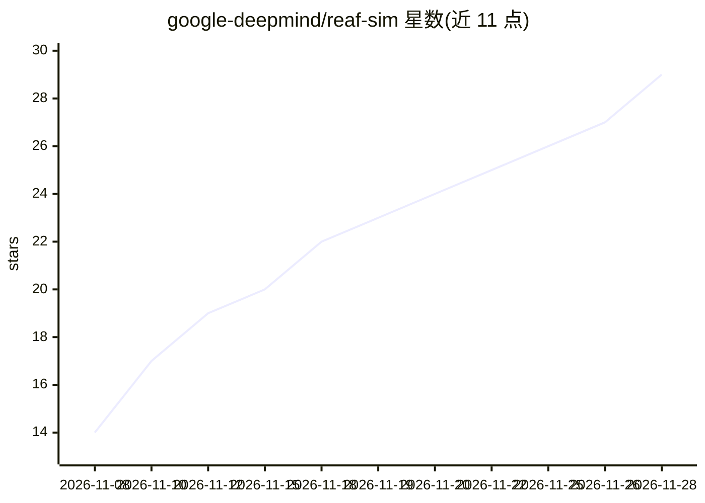

# google-deepmind/reaf-sim

⭐ 29 · Python · Apache-2.0 · 推送 2026-11-27 · [GitHub](https://github.com/google-deepmind/reaf-sim) · [官网](https://reaf-sim.readthedocs.io/) · 组织维护

**面向 sim-to-real 机器人工作流的 MuJoCo 仿真环境编写框架**

由 Google DeepMind 维护、基于 PyTorch 构建在 MuJoCo 与 MuJoCo Warp 之上的仿真环境框架。核心机制是将硬件与传感器 I/O（DeviceLayer）与任务逻辑（TaskLayer）解耦，TaskLayer 无法访问特权仿真状态，使仿真工作流可迁移到真实硬件。TaskLayer 处理动作、观测、终止与奖励的 MDP 逻辑；支持 GPU 上 16 个并行环境的摄像头 RGB 观测与 rollout 渲染。项目遵循 GDM Robotics Environment 接口，Apache 2.0 许可。限制：需配合 MuJoCo 模型使用，README 未列安装命令细节。

## 筛选速览

| 维度 | 判定 | 备注 |
|---|---|---|
| AI 角色 | `ai-ecosystem` | LLM/agent 周边工具 |
| 许可风险 | `permissive` | Apache-2.0 |
| 部署形态 | `library` | 以包/库形式分发 |
| 模型依赖 | — | README 未给出锁定关系 |
| 硬件要求 | — | 无带数字的原话,不猜 |
| 安装摩擦 | `low` | 无编译、无系统依赖或容器化 |
| 成熟度 | — | 结构信号不足 |

## 能力要点

- DeviceLayer 与 TaskLayer 解耦，屏蔽特权仿真状态以保证 sim-to-real 可移植性
- 基于 MuJoCo Warp 在 GPU 上并行运行 16 个环境并渲染 RGB 观测
- 遵循 GDM Robotics Environment 接口，提供文档与贡献指南

## 适用场景

- 机器人 RL 策略在仿真中训练后迁移到真实硬件
- 为机械臂等机器人任务编写 MDP 环境（动作/观测/奖励/终止）
- 并行 rollout 并录制视觉演示视频

## 场景标签

 · 领域:机器人/仿真

## 证据(README 行号)

> L8: `reaf-sim` is a simulation environment framework written in PyTorch and built on MuJoCo and MuJoCo Warp with the Rob
> L10: `reaf-sim` is designed explicitly for sim-to-real robotics workflows. To achieve this, we decouple hardware and sen

## 星数曲线

2026-11-08 14 → 2026-11-28 29（+15）

---
*卡片 v1 · prompt 1.4 · 生成 2026-11-18 · 置信度 mid · 依据 README sha `35254af0b868` · [字段定义](../../DATASET.md)*
