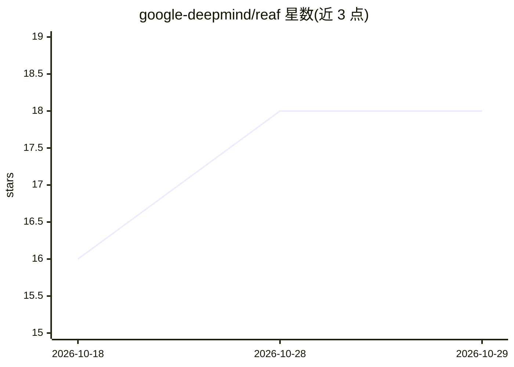

# google-deepmind/reaf

⭐ 18 · Python · Apache-2.0 · 推送 2026-10-07 · [GitHub](https://github.com/google-deepmind/reaf) · [官网](https://reaf.readthedocs.io) · 组织维护

**机器人环境编写框架：简化创建符合 GDM 接口的环境**

Google DeepMind 开源的机器人环境编写框架，用于简化创建符合 GDM Robotics Environment 接口的机器人环境。采用分层架构：Environment 顶层接口处理步进与重置，Task Layer 定义任务逻辑（奖励计算、终止条件、特征生成、命令处理），Device Layer 对接物理或仿真的机器人硬件（发送执行器命令、读取传感器测量），Adapters 在通用智能体接口与 Task Layer 之间转换动作与观测。另含 Reset 与回合结束处理器。通过 PyPI 以 pip install reaf 安装，供机器人环境开发与测试使用。

## 筛选速览

| 维度 | 判定 | 备注 |
|---|---|---|
| AI 角色 | `ai-ecosystem` | LLM/agent 周边工具 |
| 许可风险 | `permissive` | Apache-2.0 |
| 部署形态 | `library` | 以包/库形式分发 |
| 模型依赖 | — | README 未给出锁定关系 |
| 硬件要求 | — | 无带数字的原话,不猜 |
| 安装摩擦 | `low` | 无编译、无系统依赖或容器化 |
| 成熟度 | — | 结构信号不足 |

## 能力要点

- 分层架构：Environment / Task Layer / Device Layer / Adapters
- Task Layer 提供奖励、终止、折扣、特征生成与命令处理组件
- Device Layer 通过 DeviceCoordinator 管理硬件组件的命令与测量
- 提供 testing 子目录用于测试 REAF 接口与环境

## 适用场景

- 为机器人强化学习构建符合 GDM 接口的环境
- 将物理或仿真机器人设备接入统一的环境接口
- 复用奖励、终止条件等组件快速组装机器人任务

## 场景标签

`强化学习` · 领域:训练与推理

## 证据(README 行号)

> L3: The Robotics Environment Authoring Framework (REAF) simplifies creating
> L4: environments that adhere to the
> L29: REAF is a framework designed to simplify the creation of robotics environments.

## 星数曲线

2026-10-18 16 → 2026-10-29 18（+2）

---
*卡片 v1 · prompt 1.4 · 生成 2026-10-29 · 置信度 high · 依据 README sha `291ff6617131` · [字段定义](../../DATASET.md)*
