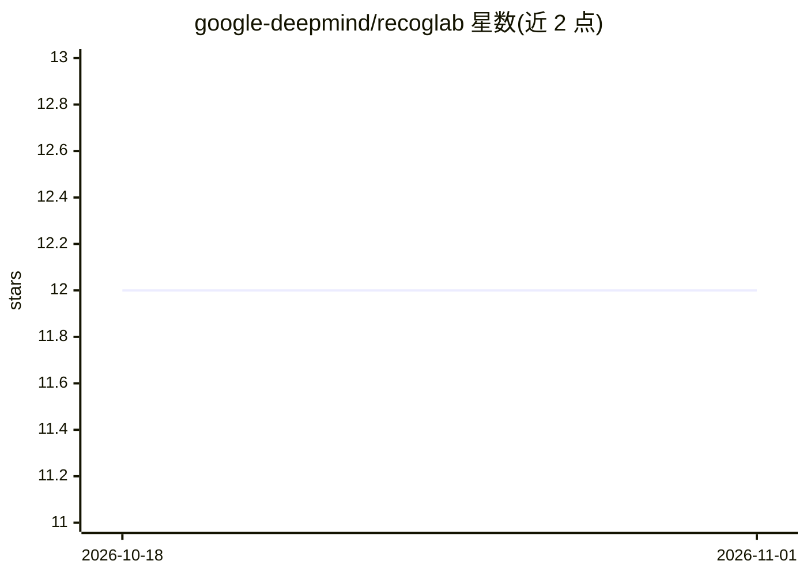

# google-deepmind/recoglab

⭐ 12 · Python · Apache-2.0 · 推送 2026-05-19 · [GitHub](https://github.com/google-deepmind/recoglab) · 组织维护

**生成关系推理文字题以测试 LLM 认知能力的研究框架**

DeepMind 随 ICLR 2025 论文发布的代码库：面向认知科学与 NLP 研究者，自动生成传递推理、图遍历、一致性检测、可判定性等多类关系推理文字题，可沿实体数量、推理长度、干扰文本等维度增加难度，用于探测 LLM 的认知效应与诊断推理能力。数据集以 TFRecords 编码，可脱离框架加载；通过 git clone 源码 + virtualenv 安装，用 python -m recoglab.generate_static_dataset 生成 .tfrecord 数据集，另有 Colab 演示与 iclr_dataset.sh 复现论文数据。论文结果依赖 jax==0.4.33（跨版本 PRNGKeys 不确定）。

## 筛选速览

| 维度 | 判定 | 备注 |
|---|---|---|
| AI 角色 | `ai-ecosystem` | LLM/agent 周边工具 |
| 许可风险 | `permissive` | Apache-2.0 |
| 部署形态 | `library` | 以包/库形式分发 |
| 模型依赖 | — | README 未给出锁定关系 |
| 硬件要求 | — | 无带数字的原话,不猜 |
| 安装摩擦 | `low` | 无编译、无系统依赖或容器化 |
| 成熟度 | — | 结构信号不足 |

## 能力要点

- 自动生成多类关系推理文字题（传递推理/图遍历/一致性检测/可判定性）
- 可沿实体数、推理长度、干扰文本等维度调节难度
- 数据集以 TFRecords 编码，可脱离框架直接加载
- 提供预定义配置、命令行覆盖参数与论文数据复现脚本

## 适用场景

- 为 LLM 认知实验快速生成可配置的推理测试题
- 诊断大模型的关系推理与多跳推理能力
- 复现论文中的实验数据集

## 场景标签

`模型评测` `科研工具` · 领域:评测与运维

## 证据(README 行号)

> L13: ReCogLab is a generative framework designed to allow researchers in cognitive science and NLP to
> L16: problems that can be used to probe for cognitive effects and diagnosing reasoning capabilities in Large Language

## 星数曲线

2026-10-18 12 → 2026-11-01 12（+0）

---
*卡片 v1 · prompt 1.4 · 生成 2026-11-01 · 置信度 mid · 依据 README sha `9e7287aa014b` · [字段定义](../../DATASET.md)*
