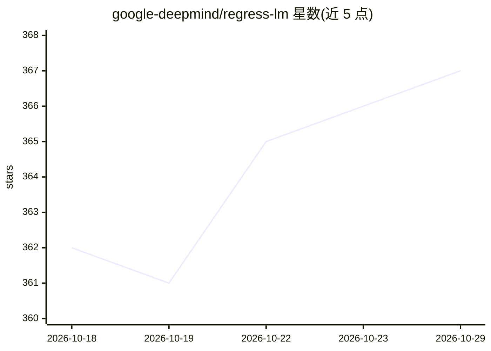

# google-deepmind/regress-lm

⭐ 367 · Python · Apache-2.0 · 推送 2026-10-22 · [GitHub](https://github.com/google-deepmind/regress-lm) · 组织维护

**序列到序列数值预测库：从可分词输入预测浮点数**

DeepMind 开源的机器学习库，实现 sequence-to-sequence 数值回归：输入任意可分词数据（文本、图像等），解码输出浮点数预测。支持预训练与微调、自定义 SentencePiece 词表、多目标预测、100K+ 长上下文编码器（Mamba、Performer），并支持 T5Gemma（V1/V2）编码器与 LoRA 微调（需 extras）。以 Python 包 pip 安装，需 Python 3.10+，Linux 环境为主。附 Colab 示例（密度估计、GPU kernel 延迟预测、Kaggle 实验结果预测）。

## 筛选速览

| 维度 | 判定 | 备注 |
|---|---|---|
| AI 角色 | `ai-native` | 本体是模型或模型工具 |
| 许可风险 | `permissive` | Apache-2.0 |
| 部署形态 | `library` | 以包/库形式分发 |
| 模型依赖 | — | README 未给出锁定关系 |
| 硬件要求 | — | 无带数字的原话,不猜 |
| 安装摩擦 | `low` | 无编译、无系统依赖或容器化 |
| 成熟度 | — | 结构信号不足 |

## 能力要点

- 任意可分词输入的 seq2seq 浮点数预测，支持预训练与微调
- 支持 T5Gemma（V1+V2）编码器与 LoRA 微调（extras）
- Mamba/Performer 编码器支持 100K+ token 长上下文
- 多目标预测与自定义词表训练

## 适用场景

- 从非结构化系统状态文本直接预测性能指标
- 对延迟、实验结果等数值指标做端到端预测
- 在自有数据上预训练后迁移到新回归任务

## 场景标签

`模型训练` `微调` · 领域:训练与推理

## 证据(README 行号)

> L13: RegressLM is a library for sequence-to-sequence numeric prediction, applicable
> L50: The intended use-case is to import a RegressLM class, which can decode

## 星数曲线

2026-10-18 362 → 2026-10-29 367（+5）

---
*卡片 v1 · prompt 1.4 · 生成 2026-10-21 · 置信度 high · 依据 README sha `83220bec253b` · [字段定义](../../DATASET.md)*
