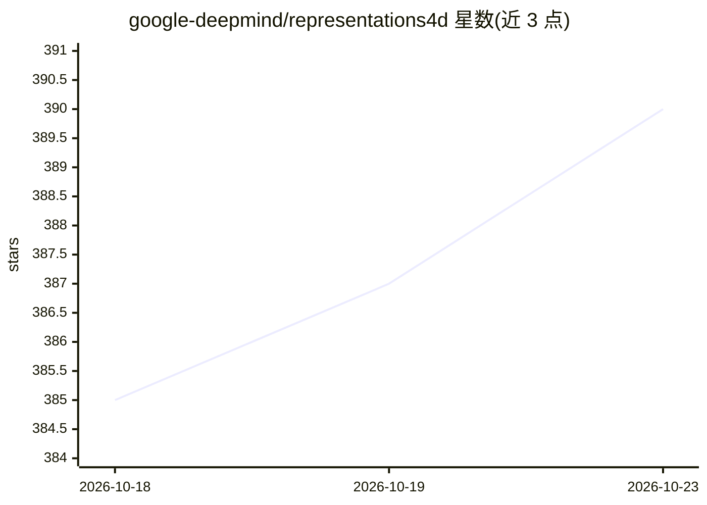

# google-deepmind/representations4d

⭐ 390 · Jupyter Notebook · Apache-2.0 · 推送 2026-10-19 · [GitHub](https://github.com/google-deepmind/representations4d) · 组织维护

**Google DeepMind 4D 视觉基础模型代码与检查点集合**

官方仓库收录 5 项 4D 时空视觉研究工作：Scaling 4D Representations（MAE 视频自监督，20M 到 22B 参数）、MooG（时空自由 token 的场景表征）、RVM（循环视频掩码自编码器）、Omnivorous DINO（多模态对齐后训练）、GenCeption（基于 WAN 2.1 扩散骨干的文本指令多任务感知）。面向科研用户，通过 git clone 后 pip install 安装，提供 6 个 Colab 演示 notebook 和 16 组模型检查点（34M 到 14B 参数，最大 26.7GB）。

## 筛选速览

| 维度 | 判定 | 备注 |
|---|---|---|
| AI 角色 | `ai-native` | 本体是模型或模型工具 |
| 许可风险 | `permissive` | Apache-2.0 |
| 部署形态 | `library` | 以包/库形式分发 |
| 模型依赖 | — | README 未给出锁定关系 |
| 硬件要求 | — | 无带数字的原话,不猜 |
| 安装摩擦 | `low` | 无编译、无系统依赖或容器化 |
| 成熟度 | — | 结构信号不足 |

## 能力要点

- 5 项 4D 视觉研究工作（自监督视频表征、跟踪、深度估计、多模态对齐、生成式感知）
- 发布 16 组模型检查点，参数规模 34M 至 14B
- 6 个 Google Colab 演示 notebook 覆盖深度估计、点跟踪、分割跟踪等任务

## 适用场景

- 复现或扩展 4D 视频自监督表征研究
- 用预训练 backbone 做深度估计、点/框跟踪等下游任务
- 在 Colab 中快速试用各模型推理

## 场景标签

`科研工具` `多模态` · 领域:学习与行业

## 证据(README 行号)

> L5: * Scaling 4D Representations focuses on evaluating self-supervised learning on non-semantic vision tasks that are mo
> L21: * GenCeption leverages a pre-trained video generative diffusion backbone (WAN 2.1) to define a feed-forward percept

## 星数曲线

2026-10-18 385 → 2026-10-23 390（+5）

---
*卡片 v1 · prompt 1.4 · 生成 2026-10-21 · 置信度 high · 依据 README sha `36d695099f88` · [字段定义](../../DATASET.md)*
