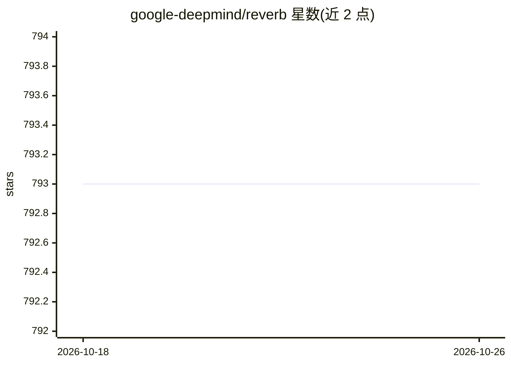

# google-deepmind/reverb

⭐ 793 · C++ · Apache-2.0 · 推送 2026-10-21 · [GitHub](https://github.com/google-deepmind/reverb) · 组织维护

**面向机器学习研究的数据存储与传输系统，主要作分布式 RL 经验回放**

DeepMind 开源的 C++ 实现数据存储与传输系统，主要用作分布式强化学习的经验回放（experience replay），同时支持 FIFO、LIFO、优先队列等多种表结构。服务器通过 gRPC 服务提供插入、采样与更新接口，提供 Python 客户端与原生 TensorFlow ops；表可配置采样/移除策略（Uniform/Prioritized/FIFO/LIFO/MinHeap/MaxHeap）、容量上限、速率限制器，支持水平分片扩展与 checkpoint 恢复。仅支持 Linux，需与特定 TensorFlow 版本配对，README 声明未针对生产环境加固。

## 筛选速览

| 维度 | 判定 | 备注 |
|---|---|---|
| AI 角色 | `ai-ecosystem` | LLM/agent 周边工具 |
| 许可风险 | `permissive` | Apache-2.0 |
| 部署形态 | `library` | 以包/库形式分发 |
| 模型依赖 | — | README 未给出锁定关系 |
| 硬件要求 | — | 无带数字的原话,不猜 |
| 安装摩擦 | `low` | 无编译、无系统依赖或容器化 |
| 成熟度 | `idea` | |

## 能力要点

- gRPC 服务架构，C++ 实现，提供 Python 客户端与 TensorFlow 原生 ops
- 6 种采样/移除选择策略与 MinSize、SampleToInsertRatio 等速率限制器
- 多服务器分片水平扩展与 checkpoint 存取恢复
- pip 安装附带 reverb_server 脚本（beta），可用 textproto 配置启动

## 适用场景

- 分布式强化学习训练中存放与采样经验回放数据
- off-policy 算法（DQN/SAC/DDPG 等）的优先经验回放缓冲区
- 用多张表组合存储 transition 与序列数据供不同训练用途

## 场景标签

`强化学习` · 领域:训练与推理

## 证据(README 行号)

> L5: Reverb is an efficient and easy-to-use data storage and transport system
> L121: Experience replay has become an important tool for training off-policy
> L127: is implemented in C++ and to enable distributed usage it provides a gRPC service

## 星数曲线

2026-10-18 793 → 2026-10-26 793（+0）

---
*卡片 v1 · prompt 1.4 · 生成 2026-10-21 · 置信度 high · 依据 README sha `8b1d46102e6f` · [字段定义](../../DATASET.md)*
