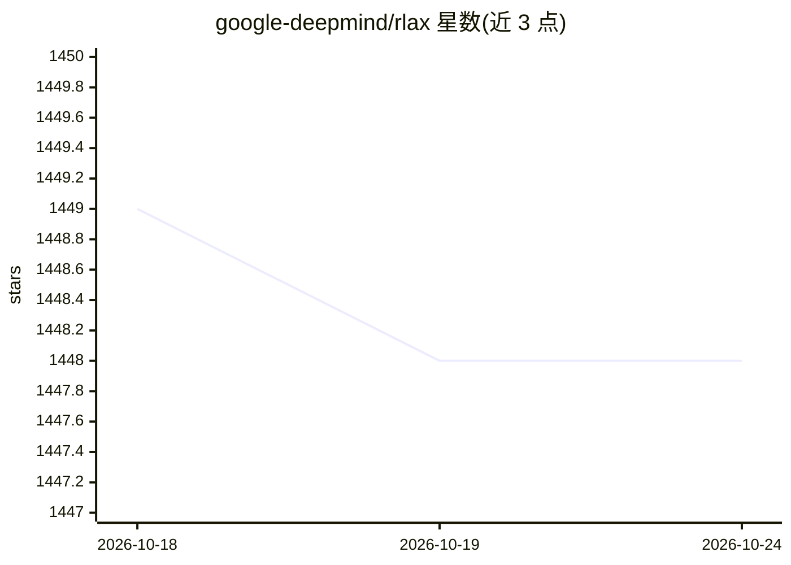

# google-deepmind/rlax

⭐ 1,448 · Python · Apache-2.0 · 推送 2026-09-09 · [GitHub](https://github.com/google-deepmind/rlax) · [官网](https://rlax.readthedocs.io) · 组织维护

**给研究者的 JAX 强化学习算子库，供构建学习型 agent**

DeepMind 维护的基于 JAX 的库，提供实现强化学习智能体所需的数学构件：状态/动作价值、Bellman 方程非线性推广、回报分布、广义价值函数与策略梯度，支持 on-policy 与 off-policy 学习；这些构件本身不是完整算法。所有代码可经 jax.jit 编译到 CPU/GPU/TPU，经 pip 安装；运行示例还需 optax、haiku 与 bsuite。函数级文档附带相关论文引用。

## 筛选速览

| 维度 | 判定 | 备注 |
|---|---|---|
| AI 角色 | `ai-ecosystem` | LLM/agent 周边工具 |
| 许可风险 | `permissive` | Apache-2.0 |
| 部署形态 | `library` | 以包/库形式分发 |
| 模型依赖 | — | README 未给出锁定关系 |
| 硬件要求 | — | 无带数字的原话,不猜 |
| 安装摩擦 | `low` | 无编译、无系统依赖或容器化 |
| 成熟度 | — | 结构信号不足 |

## 能力要点

- 提供价值函数、回报分布、策略梯度等强化学习构件
- 全部代码可 jax.jit 编译到 CPU/GPU/TPU
- 支持 on-policy 与 off-policy 学习
- 每个函数有测试并验证 jax.jit/jax.vmap 下输出

## 适用场景

- 在 JAX 中组装自定义强化学习算法
- 研究分布值函数或广义价值函数
- 在 BSuite Catch 环境上验证智能体实现

## 场景标签

`强化学习` · 领域:训练与推理

## 证据(README 行号)

> L7: RLax (pronounced "relax") is a library built on top of JAX that exposes
> L8: useful building blocks for implementing reinforcement learning agents. Full
> L37: The operations and functions provided are not complete algorithms, but

## 星数曲线

2026-10-18 1,449 → 2026-10-24 1,448（-1）

---
*卡片 v1 · prompt 1.4 · 生成 2026-10-21 · 置信度 high · 依据 README sha `05e6b61fbf53` · [字段定义](../../DATASET.md)*
