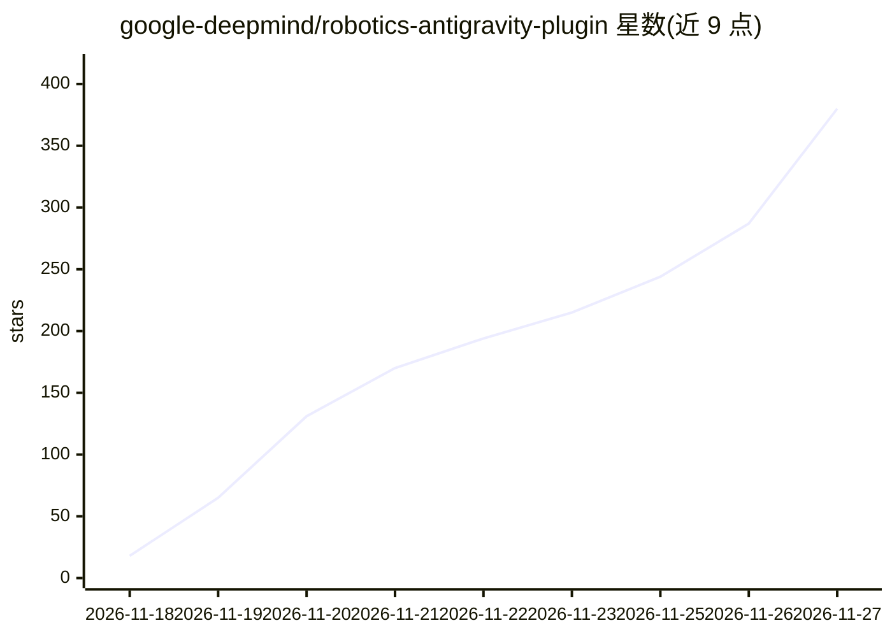

# google-deepmind/robotics-antigravity-plugin

⭐ 380 · Python · Apache-2.0 · 推送 2026-11-25 · [GitHub](https://github.com/google-deepmind/robotics-antigravity-plugin) · [官网](https://deepmind.google/models/gemini-robotics/) · 组织维护

**Google Antigravity 机器人插件：让 agent 编写控制并在仿真与真机上运行**

Google DeepMind 维护的 Google Antigravity 机器人技能插件：agent 可在 MuJoCo 仿真中编写并测试机器人控制器，再将同一代码运行于真实机械臂（如 I2RT YAM Pro、LeRobot SO-101、Franka Research 3），也可仅用仿真无需硬件。插件统一提供感知、规划、控制、sim2real、MuJoCo Studio 与机器人 bring-up 能力；调用 Gemini 感知模型的技能需设置 GEMINI_API_KEY。支持从 Marketplace、GitHub 插件安装或 npx 按需安装技能，真实机器人操作附有安全警告。

## 筛选速览

| 维度 | 判定 | 备注 |
|---|---|---|
| AI 角色 | `ai-ecosystem` | LLM/agent 周边工具 |
| 许可风险 | `permissive` | Apache-2.0 |
| 部署形态 | `library` | 以包/库形式分发 |
| 模型依赖 | — | README 未给出锁定关系 |
| 硬件要求 | — | 无带数字的原话,不猜 |
| 安装摩擦 | `low` | 无编译、无系统依赖或容器化 |
| 成熟度 | — | 结构信号不足 |

## 能力要点

- 同一控制器代码可在 MuJoCo 仿真与真实机械臂上运行
- 覆盖感知、规划、控制、sim2real、MuJoCo Studio 与 bring-up 的统一机器人插件
- 含 7 个 MuJoCo API 技能（mujoco-python、rendering、studio 等）
- 支持仅仿真工作流，无需机器人硬件

## 适用场景

- 让 Antigravity agent 在 MuJoCo 中生成并测试机器人任务仿真
- 把仿真中验证的控制器部署到真实机械臂执行抓取分拣
- 快速完成真实机械臂的 bring-up 与操作演示

## 场景标签

 · 领域:机器人/仿真

## 证据(README 行号)

> L5: The Robotics plugin brings frontier spatial reasoning, multimodal perception,
> L62:     agy plugin install https://github.com/google-deepmind/robotics-antigravity-plugin
> L114:     └── robotics/                # Unified robotics plugin (perception, planning, control, sim2real, MuJoCo Studio

## 星数曲线

2026-11-18 18 → 2026-11-27 380（+362）

---
*卡片 v1 · prompt 1.4 · 生成 2026-11-18 · 置信度 high · 依据 README sha `e50a615c2958` · [字段定义](../../DATASET.md)*
