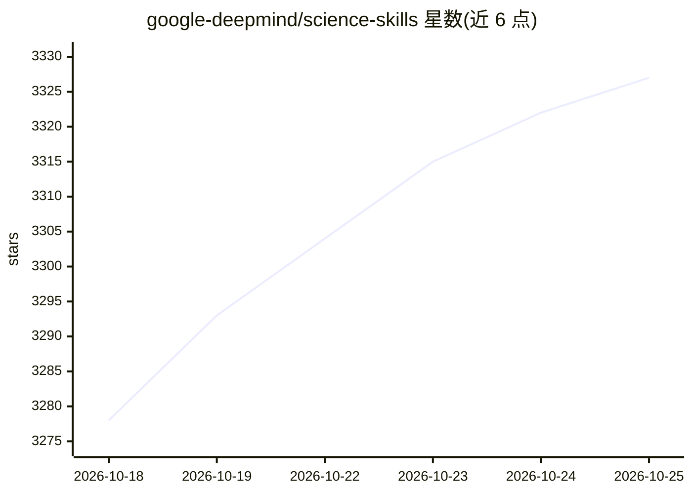

# google-deepmind/science-skills

⭐ 3,327 · Python · Apache-2.0 · 推送 2026-10-23 · [GitHub](https://github.com/google-deepmind/science-skills) · [官网](https://antigravity.google/use-cases/science) · 组织维护

**科研任务的 AI agent 技能集合，覆盖基因组学与结构生物学等**

由 google-deepmind 维护的科学 agent 技能集合：每个技能目录含 SKILL.md 指令文件、scripts/ 辅助脚本与可选 references/，用于扩展 AI agent 在基因组学、结构生物学、化学信息学、文献检索等领域的任务能力。主要使用途径为 Google Antigravity 的 Science 插件，或通过 npx skills 命令安装技能包；依赖由 uv 管理，首次触发时安装。部分技能（如 AlphaGenome、OpenAlex）需 API key，部分（如 ClinVar）无 key 仍可用。代码 Apache 2.0，其他材料 CC-BY 4.0。

## 筛选速览

| 维度 | 判定 | 备注 |
|---|---|---|
| AI 角色 | `ai-knowledge` | 知识聚合/清单类 |
| 许可风险 | `permissive` | Apache-2.0 |
| 部署形态 | `library` | 以包/库形式分发 |
| 模型依赖 | — | README 未给出锁定关系 |
| 硬件要求 | — | 无带数字的原话,不猜 |
| 安装摩擦 | `low` | 无编译、无系统依赖或容器化 |
| 成熟度 | — | 结构信号不足 |

## 能力要点

- 每个技能含 SKILL.md 指令、scripts/ 脚本与可选 references/
- 覆盖基因组学、结构生物学、化学信息学、文献检索等领域
- 支持 Google Antigravity Science 插件与 npx 命令两种使用方式
- uv 管理依赖，首次触发技能时由 agent 引导安装

## 适用场景

- 为 AI agent 添加特定科研领域能力
- 在 Google Antigravity 中执行科学查询与任务
- 基于现有技能模板定制自己的科学技能

## 场景标签

`科研工具` · 领域:学习与行业

## 证据(README 行号)

> L3: A collection of agent skills for scientific research tasks, spanning genomics,
> L6: Each skill provides structured instructions, scripts, and resources that extend

## 星数曲线

2026-10-18 3,278 → 2026-10-25 3,327（+49）

---
*卡片 v1 · prompt 1.4 · 生成 2026-10-20 · 置信度 high · 依据 README sha `f9dd3ac94c9a` · [字段定义](../../DATASET.md)*
