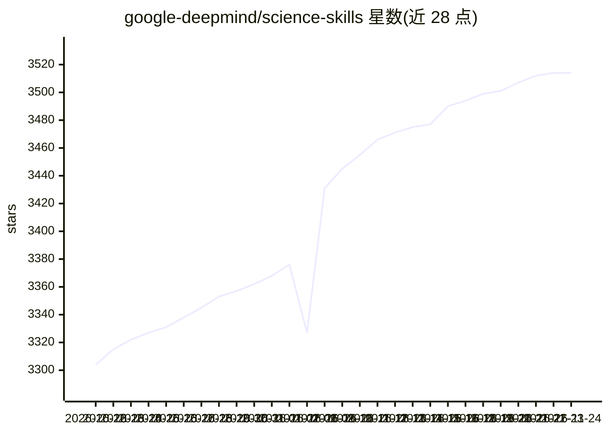

# google-deepmind/science-skills

⭐ 3,521 · Python · Apache-2.0 · 推送 2026-11-10 · [GitHub](https://github.com/google-deepmind/science-skills) · [官网](https://antigravity.google/use-cases/science) · 组织维护

**科研 agent 技能集：基因组/结构生物/文献检索等任务**

Google DeepMind 发布的科研任务 agent 技能集合，覆盖基因组学、结构生物学、文献检索等领域。每个技能目录含 SKILL.md 指令文件、辅助脚本与参考文档，用于扩展 AI agent 在专门科学任务上的能力。使用方式有两种：在 Google Antigravity 中启用 Science 插件，或通过 npx 安装技能包；依赖 uv 包管理器，部分技能（如 AlphaGenome）需配置 API key 才能运行。软件采用 Apache 2.0，其余材料采用 CC-BY 许可，README 声明非官方 Google 产品。

## 筛选速览

| 维度 | 判定 | 备注 |
|---|---|---|
| AI 角色 | `ai-knowledge` | 知识聚合/清单类 |
| 许可风险 | `permissive` | Apache-2.0 |
| 部署形态 | `library` | 以包/库形式分发 |
| 模型依赖 | — | README 未给出锁定关系 |
| 硬件要求 | — | 无带数字的原话,不猜 |
| 安装摩擦 | `low` | 无编译、无系统依赖或容器化 |
| 成熟度 | — | 结构信号不足 |

## 能力要点

- 每个技能含 SKILL.md 指令、scripts/ 辅助脚本与 references/ 文档
- 支持 Google Antigravity Science 插件与 npx skills add 两种安装方式
- 集成 AlphaGenome、AFDB、UniProt 等数据库与工具（按描述）
- 自定义技能可放置于 ~/.gemini/config/skills/ 目录

## 适用场景

- 让 agent 执行基因组学分析任务
- 让 agent 查询结构生物学数据库
- 让 agent 做文献检索
- 为科研 agent 编写自定义科学技能

## 场景标签

`科研工具` · 领域:学习与行业

## 证据(README 行号)

> L3: A collection of agent skills for scientific research tasks, spanning genomics,
> L6: Each skill provides structured instructions, scripts, and resources that extend

## 星数曲线

2026-10-22 3,304 → 2026-11-24 3,514（+210）

---
*卡片 v1 · prompt 1.4 · 生成 2026-11-23 · 置信度 high · 依据 README sha `487e1a8f17f4` · [字段定义](../../DATASET.md)*
