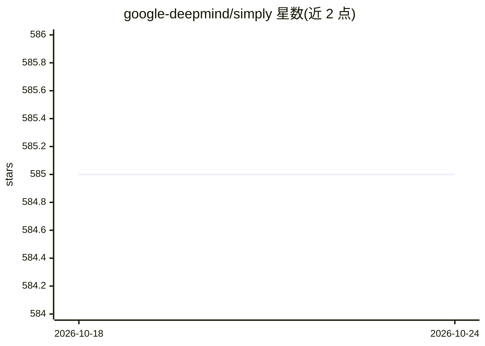

# google-deepmind/simply

⭐ 585 · Python · Apache-2.0 · 推送 2026-10-24 · [GitHub](https://github.com/google-deepmind/simply) · 组织维护

**供人与 AI agent 快速迭代 LLM 前沿研究的极简 JAX 研究代码库**

Google DeepMind 维护的 JAX 研究代码库，覆盖 LLM 及自回归模型的训练、评估与 gRPC 推理服务。设计目标是最少抽象与依赖，便于人类和 AI agent 快速 fork 修改优化器、训练损失、RL 算法等。内置模型插件库（GLM-5、Kimi K3、Qwen3.8）、研究 agent harness 与 11 项打分研究基准，另含 Amplio 长时程 agent harness。支持本地 CPU 调试、Google Cloud TPU 与 GKE 多机训练。资产（模型/数据集）从 HuggingFace 下载，当前仅含少量测试用资产。

## 筛选速览

| 维度 | 判定 | 备注 |
|---|---|---|
| AI 角色 | `ai-ecosystem` | LLM/agent 周边工具 |
| 许可风险 | `permissive` | Apache-2.0 |
| 部署形态 | `library` | 以包/库形式分发 |
| 模型依赖 | — | README 未给出锁定关系 |
| 硬件要求 | — | 无带数字的原话,不猜 |
| 安装摩擦 | `low` | 无编译、无系统依赖或容器化 |
| 成熟度 | — | 结构信号不足 |

## 能力要点

- 训练/评估/gRPC 服务全流程的极简 JAX 代码库
- 模型插件库含 GLM-5、Kimi K3、Qwen3.8
- 内置 agent harness 与 11 项打分研究基准（research_bench）
- 支持 Cloud TPU 与 GKE/XPK 多机训练

## 适用场景

- 快速实现并实验新的优化器、损失或 RL 算法
- 让 AI agent 自主读代码、设计并运行实验
- 在 TPU/GKE 上做前沿 LLM 训练与评估

## 场景标签

`科研工具` `模型训练` `模型评测` · 领域:评测与运维

## 证据(README 行号)

> L3: *Simply* is a minimal and scalable research codebase in JAX, designed as an environment where both humans and AI age
> L5: - *Quick to fork and hack* for fast iteration. We aim at minimizing the time to implement new ideas (e.g., optimizer
> L7: - *An environment for automated AI research* An AI agent, which can itself be powered by an LLM served with *Simply*

## 星数曲线

2026-10-18 585 → 2026-10-24 585（+0）

---
*卡片 v1 · prompt 1.4 · 生成 2026-10-21 · 置信度 high · 依据 README sha `1c680949db65` · [字段定义](../../DATASET.md)*
