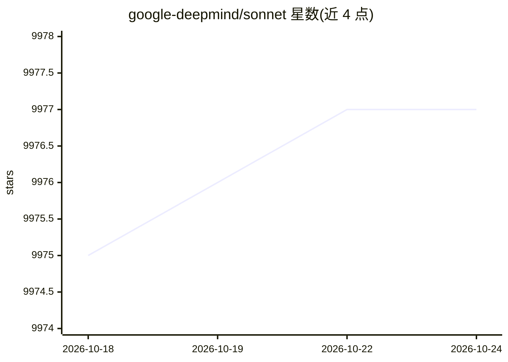

# google-deepmind/sonnet

⭐ 9,977 · Python · Apache-2.0 · 推送 2026-10-20 · [GitHub](https://github.com/google-deepmind/sonnet) · [官网](https://sonnet.dev/) · 组织维护

**DeepMind 研究者构建神经网络的 TensorFlow 2 库**

构建在 TensorFlow 2 之上的神经网络库，面向机器学习研究者。核心抽象是 snt.Module：可持有参数、子模块并应用函数于输入；内置 Linear、Conv2D、BatchNorm 及 MLP 等预定义模块与网络，用户可继承自定义模块。库不自带训练框架，用户需自行搭建或采用他人方案；支持 pickle 序列化、TensorFlow Checkpointing、Saved Model 及基于自定义分布式策略的分布式训练（多 GPU）。通过 pip 安装 dm-sonnet，示例含 MNIST、GAN 等 Colab notebook。

## 筛选速览

| 维度 | 判定 | 备注 |
|---|---|---|
| AI 角色 | `ai-ecosystem` | LLM/agent 周边工具 |
| 许可风险 | `permissive` | Apache-2.0 |
| 部署形态 | `library` | 以包/库形式分发 |
| 模型依赖 | — | README 未给出锁定关系 |
| 硬件要求 | — | 无带数字的原话,不猜 |
| 安装摩擦 | `low` | 无编译、无系统依赖或容器化 |
| 成熟度 | — | 结构信号不足 |

## 能力要点

- 以 snt.Module 为中心的可组合编程模型
- 内置预定义模块（Linear/Conv2D/BatchNorm）与 MLP 网络
- 支持 TensorFlow Checkpointing、Saved Model 序列化
- 基于自定义分布式策略的多 GPU 分布式训练支持

## 适用场景

- 研究者在 TensorFlow 2 上搭建监督/无监督/强化学习模型
- 需要自主控制训练流程与梯度同步的实验
- 导出 Saved Model 供其他机器加载推理

## 场景标签

 · 领域:机器学习/深度学习框架

## 证据(README 行号)

> L7: Sonnet is a library built on top of TensorFlow 2
> L13: Sonnet has been designed and built by researchers at DeepMind. It can be used to
> L14: construct neural networks for many different purposes (un/supervised learning,

## 星数曲线

2026-10-18 9,975 → 2026-10-24 9,977（+2）

---
*卡片 v1 · prompt 1.4 · 生成 2026-10-20 · 置信度 high · 依据 README sha `e92b18e2276a` · [字段定义](../../DATASET.md)*
