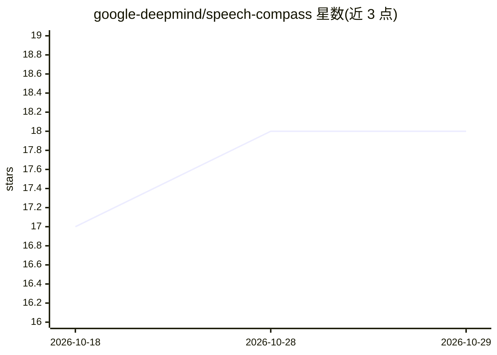

# google-deepmind/speech-compass

⭐ 18 · Java · Apache-2.0 · 推送 2026-07-03 · [GitHub](https://github.com/google-deepmind/speech-compass) · 组织维护

**移动语音转文字的实时说话人定位与方向指引系统（听障无障碍）**

CHI 2025 论文的官方代码发布：面向听障用户的移动字幕增强系统。通过 4 麦克风手机壳与 STM32 L5 微控制器运行 GCC-PHAT 定位（C11 DSP 算法），将说话人方位经 USB 流式传输至 Android 应用，在实时字幕上叠加彩色文本、方向箭头、雷达小地图等可视化；DSP 算法也可在带 2+ 麦克风的手机上运行实现 180° 定位。仓库含 Android 应用、C 算法（Bazel 测试）、固件与 PCB 原理图四个可独立使用的组件，无需硬件即可构建测试算法。

## 筛选速览

| 维度 | 判定 | 备注 |
|---|---|---|
| AI 角色 | `ai-native` | 本体是模型或模型工具 |
| 许可风险 | `permissive` | Apache-2.0 |
| 部署形态 | `None` |  |
| 模型依赖 | — | README 未给出锁定关系 |
| 硬件要求 | — | 无带数字的原话,不猜 |
| 安装摩擦 | `low` | 无编译、无系统依赖或容器化 |
| 成熟度 | — | 结构信号不足 |

## 能力要点

- GCC-PHAT + 核密度估计的经典 DSP 定位，运行于低功耗微控制器，不保留语音数据
- 定位误差 11°–22°，4 麦配置的 DER 相对 3 麦提升 23–35%
- 彩色文本/方向箭头/雷达小地图/边缘指示/方向语音抑制等可视化
- 硬件原理图与固件开源，同一硬件可运行前作 LiveLocalizer 固件

## 适用场景

- 听障用户在多人对话中区分谁在说话及方向
- 构建或复用无需额外硬件的移动端说话人定位字幕应用
- 复现 CHI 2025 论文的 DSP 算法与用户研究流程

## 场景标签

`语音识别` · 领域:感知与多模态

## 证据(README 行号)

> L85: Mobile speech-to-text apps have a fundamental limitation in group conversations: they
> L88: microphones to localize speakers in real time and overlay directional guidance on live
> L131: - The **Android app** uses the phone's built-in microphone for speech recognition (ASR)

## 星数曲线

2026-10-18 17 → 2026-10-29 18（+1）

---
*卡片 v1 · prompt 1.4 · 生成 2026-10-29 · 置信度 high · 依据 README sha `e813fb8b606c` · [字段定义](../../DATASET.md)*
