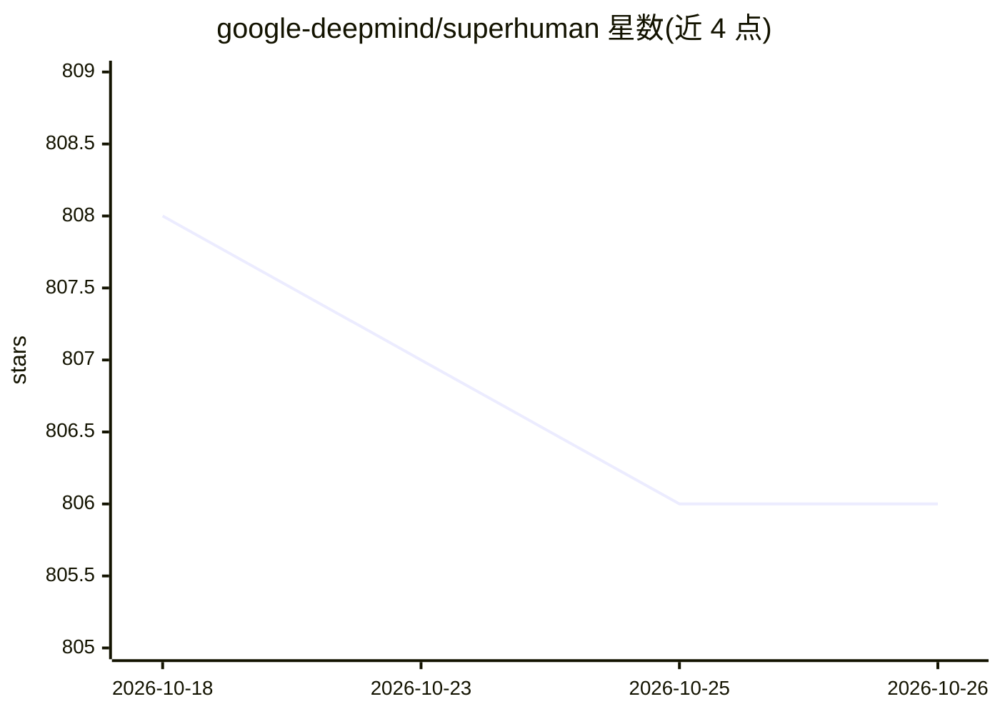

# google-deepmind/superhuman

⭐ 806 · Lean · Apache-2.0 · 推送 2026-10-20 · [GitHub](https://github.com/google-deepmind/superhuman) · 组织维护

**DeepMind 超人推理团队的项目与数据集合集仓库**

Google DeepMind Superhuman Reasoning 团队（Thang Luong 领导）的聚合仓库，收录多个项目与数据集：AlphaGeometry（Nature 论文）、AlphaGeometry2（2024 IMO 银牌成果）、IMO Bench 基准套件（含 400 道简答题、60 道专家审校证明题、1000 条人工评分数据的 IMO-GradingBench）、以及数学研究 agent Aletheia（基于 Gemini Deep Think）的提示词与输出。多数内容链接至独立仓库，本仓库以清单与数据发布为主。

## 筛选速览

| 维度 | 判定 | 备注 |
|---|---|---|
| AI 角色 | `ai-knowledge` | 知识聚合/清单类 |
| 许可风险 | `permissive` | Apache-2.0 |
| 部署形态 | `None` |  |
| 模型依赖 | — | README 未给出锁定关系 |
| 硬件要求 | — | 无带数字的原话,不猜 |
| 安装摩擦 | `low` | 无编译、无系统依赖或容器化 |
| 成熟度 | — | 结构信号不足 |

## 能力要点

- 汇集 AlphaGeometry / AlphaGeometry2 等项目入口
- IMO Bench 三个子基准：AnswerBench / ProofBench / GradingBench
- Aletheia 数学研究 agent 的提示词与输出数据

## 适用场景

- 查找超人推理团队各项目的官方入口与论文
- 使用 IMO 系列基准评测数学推理模型
- 研究数学研究 agent 的提示词与输出样例

## 场景标签

`模型评测` `精选清单` · 领域:评测与运维

## 证据(README 行号)

> L3: This repository hosts projects and datasets created by Google DeepMind's
> L16: A suite of advanced benchmarks designed to evaluate robust mathematical
> L29: A math research agent, powered by Gemini Deep Think, that can iteratively

## 星数曲线

2026-10-18 808 → 2026-10-26 806（-2）

---
*卡片 v1 · prompt 1.4 · 生成 2026-10-21 · 置信度 high · 依据 README sha `a682a912593f` · [字段定义](../../DATASET.md)*
