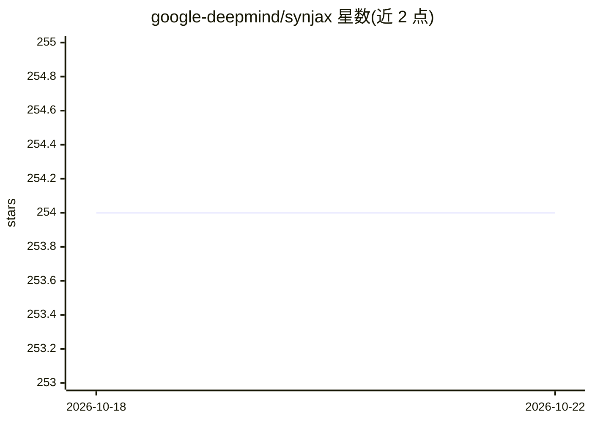

# google-deepmind/synjax

⭐ 254 · Python · Apache-2.0 · 推送 2026-02-20 · [GitHub](https://github.com/google-deepmind/synjax) · 组织维护

**面向 JAX 的结构化概率分布神经网络库**

由 Google DeepMind 维护的 Python 库，在 JAX 上实现结构化概率分布：线性链/半马尔可夫/句法树/生成树 CRF、单调与非单调对齐 CRF、CTC、PCFG（含张量分解）、HMM 等。支持计算结构对数概率、边缘概率、argmax、采样、top-k、熵、交叉熵、KL 散度等操作，并兼容 jax.vmap/jit/pmap/grad（argmax、sample、top-k 除外，不支持 grad）。纯 Python 编写，经 JAX 依赖 C++；因 CUDA 版本差异，未把 JAX 列入依赖，需先自行安装 JAX，再通过 pip 从 GitHub 安装。附 Colab 示例笔记本。

## 筛选速览

| 维度 | 判定 | 备注 |
|---|---|---|
| AI 角色 | `ai-native` | 本体是模型或模型工具 |
| 许可风险 | `permissive` | Apache-2.0 |
| 部署形态 | `library` | 以包/库形式分发 |
| 模型依赖 | — | README 未给出锁定关系 |
| 硬件要求 | — | 无带数字的原话,不猜 |
| 安装摩擦 | `medium` | 含编译或系统依赖之一 |
| 成熟度 | — | 结构信号不足 |

## 能力要点

- 10 类结构化分布：多种 CRF、对齐、PCFG（含张量分解）、HMM
- 支持 log-prob、边际概率、argmax、采样、top-k、熵、KL 散度等操作
- 兼容 jax.vmap/jit/pmap/grad 变换（argmax/sample/top-k 不支持 grad）
- 提供 Colab 示例笔记本

## 适用场景

- 在 JAX 中为序列标注、句法分析、对齐任务建模结构化输出分布
- 在自研模型中计算结构边际概率或最可能结构
- 学习 JAX 生态下结构化预测的实现方式

## 场景标签

 · 领域:机器学习库/结构化预测

## 证据(README 行号)

> L10: SynJax is a neural network library for JAX structured probability
> L13: * Linear Chain CRF,

## 星数曲线

2026-10-18 254 → 2026-10-22 254（+0）

---
*卡片 v1 · prompt 1.4 · 生成 2026-10-22 · 置信度 high · 依据 README sha `025cfa723fd5` · [字段定义](../../DATASET.md)*
