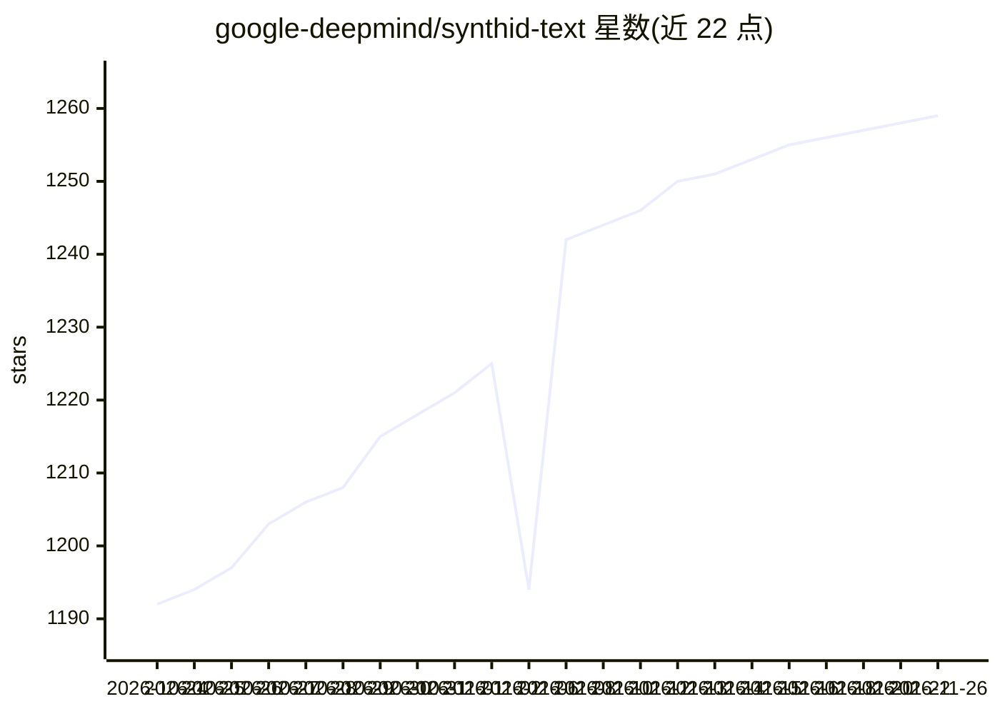

# google-deepmind/synthid-text

⭐ 1,259 · Python · Apache-2.0 · 推送 2026-11-18 · [GitHub](https://github.com/google-deepmind/synthid-text) · 组织维护

**LLM 输出文本的水印嵌入与检测参考实现库**

SynthID Text 的参考实现，对应发表于 Nature 的论文，提供文本水印嵌入与检测两类能力：通过 mix-in 扩展 Hugging Face Transformers 的 Gemma3/GPT-2 模型类，在 PyTorch 生成流程中对采样分布施加锦标赛水印；检测支持免训练的 Frequentist 检测器（返回二项 p 值）与需按密钥训练的 Bayesian 检测器（JAX）。核心库发布于 PyPI，另有 Colab 示例与人类评测数据。明确声明仅供研究与复现，静态配置不适合生产使用。

## 筛选速览

| 维度 | 判定 | 备注 |
|---|---|---|
| AI 角色 | `ai-native` | 本体是模型或模型工具 |
| 许可风险 | `permissive` | Apache-2.0 |
| 部署形态 | `library` | 以包/库形式分发 |
| 模型依赖 | — | README 未给出锁定关系 |
| 硬件要求 | — | 无带数字的原话,不猜 |
| 安装摩擦 | `medium` | 含编译或系统依赖之一 |
| 成熟度 | — | 结构信号不足 |

## 能力要点

- 通过 mix-in 扩展 Transformers 模型类，在生成时嵌入水印
- Frequentist 检测器免训练，返回精确二项 p 值
- Bayesian 检测器支持在 NVIDIA GPU 上训练（cuda extra）
- 提供双密钥投机解码（speculative decoding）独立实现

## 适用场景

- 为模型生成的文本添加可检测的水印标记
- 检测某段文本是否带有指定密钥的水印
- 复现论文中的水印实验结果

## 场景标签

 · 领域:LLM 基础设施/水印与溯源

## 证据(README 行号)

> L3: This repository provides a reference implementation of the SynthID Text
> L17:  [Hugging Face Transformers][transformers] with a [mix-in][synthid-mixin] to
> L20: 1. Detects the watermark. This can be done either with the [Frequentist

## 星数曲线

2026-10-24 1,192 → 2026-11-26 1,259（+67）

---
*卡片 v1 · prompt 1.4 · 生成 2026-11-24 · 置信度 high · 依据 README sha `708da7a2f4e0` · [字段定义](../../DATASET.md)*
