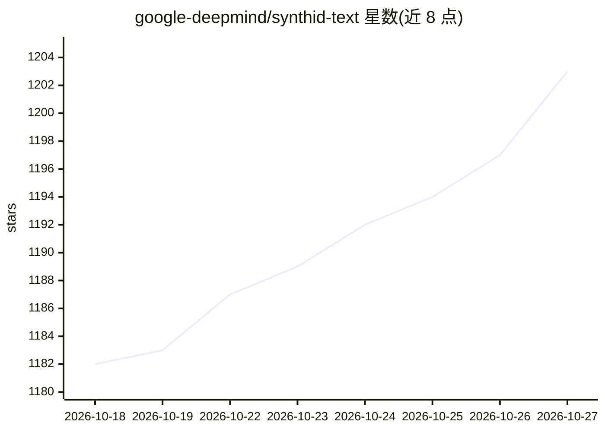

# google-deepmind/synthid-text

⭐ 1,203 · Python · Apache-2.0 · 推送 2026-10-26 · [GitHub](https://github.com/google-deepmind/synthid-text) · 组织维护

**LLM 文本水印的参考实现：为模型输出加水印并检测**

DeepMind 发表于 Nature 的 SynthID Text 论文的参考实现，提供 LLM 生成文本的水印嵌入与检测能力。通过 mix-in 扩展 Hugging Face Transformers 的 Gemma 与 GPT-2 模型类，在 PyTorch 推理时施加静态水印配置；检测支持 Mean、Weighted Mean（免训练）与 Bayesian（需按水印键训练）三种打分函数，另发布 Gemma 7B 人工评估数据。核心库发布于 PyPI，配 Colab 笔记本；明确声明仅为研究与复现用途、不建议用于生产，生产实现见 Transformers 官方集成。

## 筛选速览

| 维度 | 判定 | 备注 |
|---|---|---|
| AI 角色 | `ai-native` | 本体是模型或模型工具 |
| 许可风险 | `permissive` | Apache-2.0 |
| 部署形态 | `library` | 以包/库形式分发 |
| 模型依赖 | — | README 未给出锁定关系 |
| 硬件要求 | — | 无带数字的原话,不猜 |
| 安装摩擦 | `low` | 无编译、无系统依赖或容器化 |
| 成熟度 | `idea` | |

## 能力要点

- mix-in 扩展 GemmaForCausalLM 与 GPT2LMHeadModel 实现水印化生成
- 三种检测打分函数：Mean / Weighted Mean / Bayesian（Bayesian 需训练）
- 随论文发布人工评估数据（data/human_eval.jsonl）
- 核心库以 PyPI 包分发，配套自包含 Colab 笔记本

## 适用场景

- 研究人员复现 Nature 论文中的水印与检测结果
- 在 Gemma 或 GPT-2 生成文本中嵌入水印并验证可检测性
- 研究不同检测器（免训练/需训练）的阈值与误报率设置

## 场景标签

`科研工具` · 领域:学习与行业

## 证据(README 行号)

> L3: This repository provides a reference implementation of the SynthID Text
> L4: watermarking and detection capabilities for the [research paper][nature-paper]
> L18:  enable watermarking text content generated by models running in

## 星数曲线

2026-10-18 1,182 → 2026-10-27 1,203（+21）

---
*卡片 v1 · prompt 1.4 · 生成 2026-10-21 · 置信度 high · 依据 README sha `4c5da836e418` · [字段定义](../../DATASET.md)*
