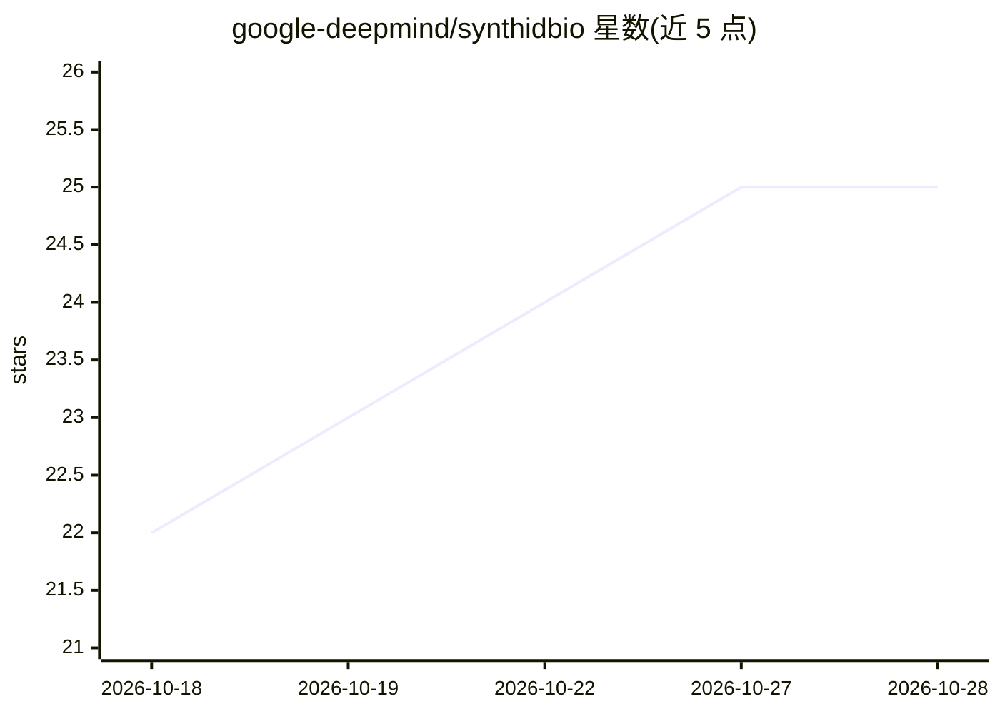

# google-deepmind/synthidbio

⭐ 25 · Apache-2.0 · 推送 2026-10-08 · [GitHub](https://github.com/google-deepmind/synthidbio) · 组织维护

**DeepMind 的 AI 生成生物序列/结构水印方法套件**

Google DeepMind 开发的生物序列与结构水印方法族：SynthID Bio-structure 为微调版 AlphaFold 3，在采样时向 3D 生物分子结构嵌入水印（权重与运行指引见 AlphaFold 3 仓库）；SynthID Bio-sequence 将水印采样集成进 ProteinMPNN 的自回归解码，保持功能与表达性，可作为既有蛋白设计管线的 drop-in 替换。通过 g 值（基线约 0.5，水印后显著升高）检测水印，提供独立 FASTA g 值计算脚本与测试套件；方法模型无关，可接入其他自回归蛋白解码器。

## 筛选速览

| 维度 | 判定 | 备注 |
|---|---|---|
| AI 角色 | `ai-native` | 本体是模型或模型工具 |
| 许可风险 | `permissive` | Apache-2.0 |
| 部署形态 | `library` | 以包/库形式分发 |
| 模型依赖 | — | README 未给出锁定关系 |
| 硬件要求 | — | 无带数字的原话,不猜 |
| 安装摩擦 | `low` | 无编译、无系统依赖或容器化 |
| 成熟度 | — | 结构信号不足 |

## 能力要点

- ProteinMPNN 解码中嵌入水印，可作为 drop-in 替换接入既有管线
- g 值检测（水印前约 0.5 基线）与独立 FASTA g 值计算脚本
- SynthIDLogitsProcessor 可集成到其他自回归蛋白序列解码器
- 包含 pytest 测试套件验证水印生成与检测

## 适用场景

- 在 AI 生成的蛋白序列中嵌入可检测水印用于溯源
- 对已有 FASTA 序列文件计算 g 值判断是否含水印
- 为自研蛋白序列解码器接入水印采样逻辑

## 场景标签

 · 领域:计算生物学/AI 安全

## 证据(README 行号)

> L3: SynthID Bio is a family of methods developed by Google DeepMind for embedding
> L11: SynthID Bio provides watermarking for autoregressive inverse folding models
> L18:  sequences during autoregressive decoding with ProteinMPNN while preserving

## 星数曲线

2026-10-18 22 → 2026-10-28 25（+3）

---
*卡片 v1 · prompt 1.4 · 生成 2026-10-27 · 置信度 mid · 依据 README sha `eb1263008f43` · [字段定义](../../DATASET.md)*
