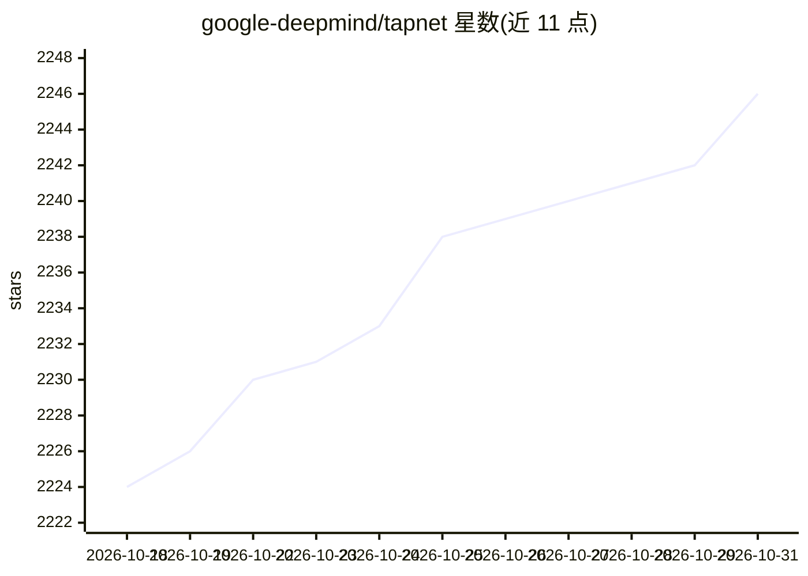

# google-deepmind/tapnet

⭐ 2,246 · Jupyter Notebook · Apache-2.0 · 推送 2026-09-15 · [GitHub](https://github.com/google-deepmind/tapnet) · [官网](https://deepmind-tapir.github.io/blogpost.html) · 组织维护

**视频任意点跟踪的模型、数据集与评测基准官方仓库**

Google DeepMind 的 Tracking Any Point 官方仓库，包含 TAPIR、BootsTAPIR、TAPNext、TAPNext++、TRAJAN 等点跟踪模型及预训练权重（Jax 与 PyTorch），并提供 TAP-Vid、RoboTAP、TAPVid-3D 三个评测基准（数据集、指标与评测代码）。面向计算机视觉与机器人研究开发者：可通过 Colab demo 或克隆仓库在本地 GPU 上运行实时演示（实测在 Quadro RTX 4000 上约 17fps），仓库还提供 Jax 训练框架用于在 Kubric 上训练模型。

## 筛选速览

| 维度 | 判定 | 备注 |
|---|---|---|
| AI 角色 | `ai-native` | 本体是模型或模型工具 |
| 许可风险 | `permissive` | Apache-2.0 |
| 部署形态 | `library` | 以包/库形式分发 |
| 模型依赖 | — | README 未给出锁定关系 |
| 硬件要求 | — | 无带数字的原话,不猜 |
| 安装摩擦 | `medium` | 含编译或系统依赖之一 |
| 成熟度 | — | 结构信号不足 |

## 能力要点

- TAPIR/TAPNext 等点跟踪模型提供 Jax 与 PyTorch 预训练权重
- TAP-Vid / RoboTAP / TAPVid-3D 三个评测基准（数据集+指标+评测代码）
- 在线 Colab demo 与本地实时摄像头跟踪演示
- 提供 Jax 训练与评测框架

## 适用场景

- 在视频中对任意物理表面点做长程跟踪
- 用 TAP-Vid/TAPVid-3D 基准评测点跟踪模型
- 机器人操控任务中利用点轨迹做分割与模仿（RoboTAP）
- 评估生成式视频模型的运动真实性（TRAJAN）

## 场景标签

`模型评测` `图像视频处理` `模型训练` · 领域:评测与运维

## 证据(README 行号)

> L9: - TAP-Vid is a benchmark for models that perform this task, with a collection of ground-truth points for both real a
> L10: - TAPIR is a two-stage algorithm which employs two stages: 1) a matching stage, which independently locates a suita
> L22: - TAP-Vid Benchmark for both evaluation **dataset** and evaluation **metrics**

## 星数曲线

2026-10-18 2,224 → 2026-10-31 2,246（+22）

---
*卡片 v1 · prompt 1.4 · 生成 2026-10-21 · 置信度 mid · 依据 README sha `7ac14ebcb739` · [字段定义](../../DATASET.md)*
