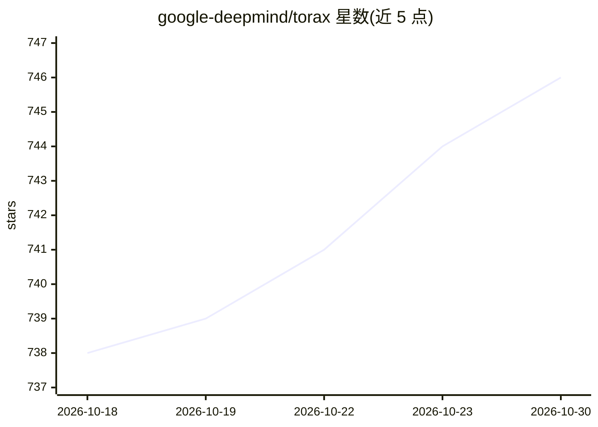

# google-deepmind/torax

⭐ 746 · Python · NOASSERTION · 推送 2026-10-29 · [GitHub](https://github.com/google-deepmind/torax) · [官网](https://torax.readthedocs.io) · 组织维护

**基于 JAX 的托卡马克芯部输运可微分模拟器**

用 Python/JAX 编写的开源托卡马克等离子体芯部输运模拟器，面向聚变研究的正向建模、脉冲设计、轨迹优化与控制器设计工作流。求解离子/电子热输运、粒子输运与电流扩散的耦合 PDE，提供线性与非线性多种求解器；可微分性支持梯度优化与参数敏感性分析，可耦合 QLKNN 神经网络代理湍流输运模型及用户自定义 ML 代理。通过 PyPI 安装，run_torax 命令行运行。

## 筛选速览

| 维度 | 判定 | 备注 |
|---|---|---|
| AI 角色 | `ai-native` | 本体是模型或模型工具 |
| 许可风险 | `none` | NOASSERTION |
| 部署形态 | `library` | 以包/库形式分发 |
| 模型依赖 | — | README 未给出锁定关系 |
| 硬件要求 | — | 无带数字的原话,不猜 |
| 安装摩擦 | `low` | 无编译、无系统依赖或容器化 |
| 成熟度 | — | 结构信号不足 |

## 能力要点

- 离子/电子热输运、粒子输运与电流扩散耦合 PDE 求解（有限体积离散）
- JAX 自动微分与编译，支持梯度优化与敏感性分析
- 耦合 QLKNN_7_11 / QLKNN10D 神经网络湍流输运代理与 ICRH ML 代理
- 支持 CHEASE/FBT/EQDSK 平衡文件的一般几何与时间演化几何

## 适用场景

- 聚变研究中做托卡马克等离子体输运正向建模
- 脉冲设计与轨迹优化、控制器设计工作流
- 用 ML 代理模型替换物理模型做快速仿真
- 对半经验模型做数据驱动的参数辨识

## 场景标签

 · 领域:聚变物理/科学计算

## 证据(README 行号)

> L5: TORAX is a differentiable tokamak core transport simulator aimed for fast
> L7: controller design workflows. TORAX is written in Python using JAX, with

## 星数曲线

2026-10-18 738 → 2026-10-30 746（+8）

---
*卡片 v1 · prompt 1.4 · 生成 2026-10-21 · 置信度 high · 依据 README sha `33bb80125701` · [字段定义](../../DATASET.md)*
