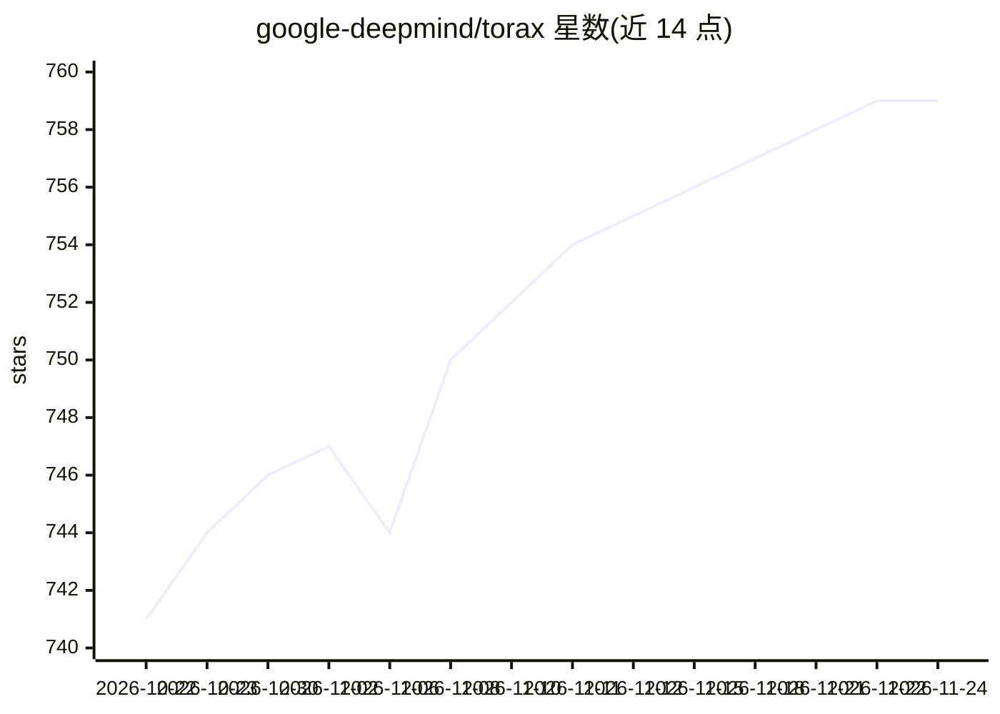

# google-deepmind/torax

⭐ 759 · Python · NOASSERTION · 推送 2026-11-23 · [GitHub](https://github.com/google-deepmind/torax) · [官网](https://torax.readthedocs.io) · 组织维护

**面向聚变科研的可微分托卡马克一维输运模拟器**

基于 Python 与 JAX 编写的托卡马克芯部等离子体一维输运模拟器，用于快速正向建模、脉冲设计、轨迹优化与控制器设计。求解离子/电子热输运、粒子输运与极向磁通扩散的有限体积 PDE，支持预测-校正、Newton-Raphson 等多种求解器；输运模型可选用 ML 代理（QLKNN、TGLFNN）、经验模型或准线性模型，平衡数据支持 CHEASE、MEQ、EQDSK、IMAS 等。要求 Python ≥3.12，从 PyPI 安装，提供 CLI 与 Python API 两种运行方式。

## 筛选速览

| 维度 | 判定 | 备注 |
|---|---|---|
| AI 角色 | `ai-enhanced` | 去掉 AI 部分产品仍成立 |
| 许可风险 | `none` | NOASSERTION |
| 部署形态 | `library` | 以包/库形式分发 |
| 模型依赖 | — | README 未给出锁定关系 |
| 硬件要求 | — | 无带数字的原话,不猜 |
| 安装摩擦 | `low` | 无编译、无系统依赖或容器化 |
| 成熟度 | — | 结构信号不足 |

## 能力要点

- 端到端 jax.jit 编译支持 CPU/GPU，jax.grad/vmap 支持灵敏度分析与参数优化
- 输运模型可选 ML 代理（QLKNN/TGLFNN）、Bohm/gyro-Bohm 经验模型、QuaLiKiz/TGLF 准线性模型
- 自定义模型注册机制：输运、源项、新经典效应等可插拔
- 内置 Extended Lengyel SOL/偏滤器模型耦合与锯齿崩溃模型

## 适用场景

- 托卡马克脉冲放电的正向模拟与剖面预测
- 基于梯度的加热/电流驱动轨迹优化
- 聚变装置的控制器设计与仿真验证
- 神经网络上游代理模型在输运求解中的耦合评估

## 场景标签

`科研工具` · 领域:学习与行业

## 证据(README 行号)

> L6: TORAX is a differentiable 1D tokamak core plasma transport simulator written in
> L16: - **ML-surrogate native**: Seamless JAX coupling to neural-network physics

## 星数曲线

2026-10-22 741 → 2026-11-24 759（+18）

---
*卡片 v1 · prompt 1.4 · 生成 2026-11-24 · 置信度 mid · 依据 README sha `ecb8d845edea` · [字段定义](../../DATASET.md)*
