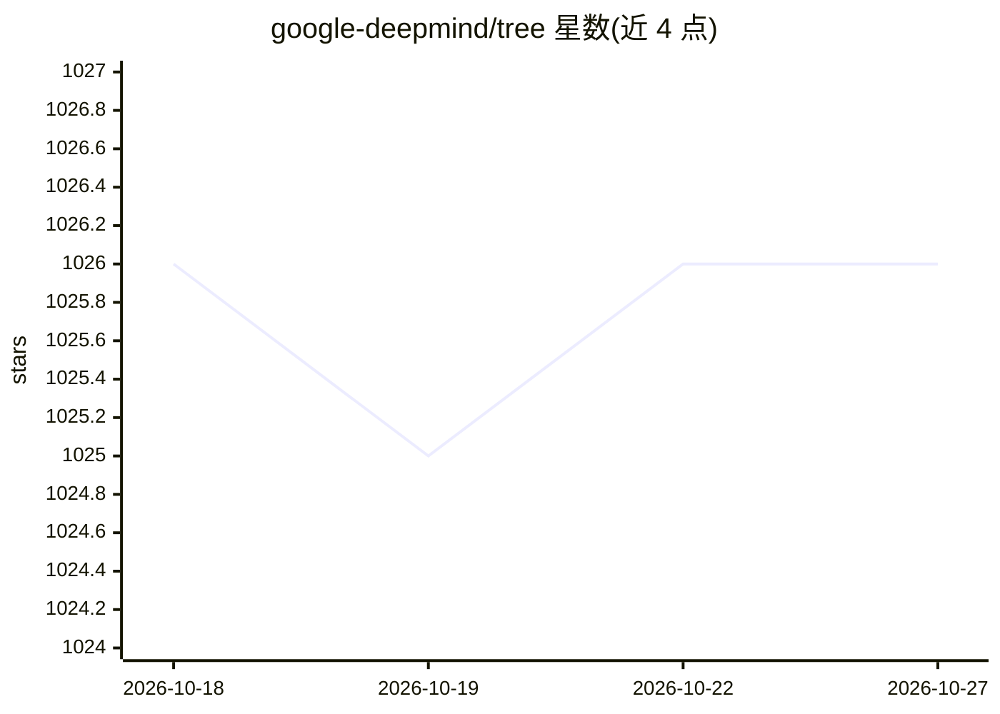

# google-deepmind/tree

⭐ 1,026 · Python · Apache-2.0 · 推送 2026-10-21 · [GitHub](https://github.com/google-deepmind/tree) · [官网](https://tree.readthedocs.io) · 组织维护

**处理嵌套数据结构的 Python 库，保留结构地映射与展平叶子**

DeepMind 开源的嵌套数据结构操作库：提供 flatten、map_structure 等函数，将函数应用到嵌套结构（list/tuple/dict 等）的每个叶子并保持整体结构，是内置 map 的泛化。底层为优化的 C++ 实现，README 提到适用于机器学习模型等性能要求较高的场景。以 Python 包 dm-tree 形式发布在 PyPI，也可从 GitHub 安装或从源码构建。

## 筛选速览

| 维度 | 判定 | 备注 |
|---|---|---|
| AI 角色 | `ai-enhanced` | 去掉 AI 部分产品仍成立 |
| 许可风险 | `permissive` | Apache-2.0 |
| 部署形态 | `library` | 以包/库形式分发 |
| 模型依赖 | — | README 未给出锁定关系 |
| 硬件要求 | — | 无带数字的原话,不猜 |
| 安装摩擦 | `low` | 无编译、无系统依赖或容器化 |
| 成熟度 | — | 结构信号不足 |

## 能力要点

- flatten / map_structure 等嵌套结构操作，泛化内置 map
- C++ 优化实现
- 以 dm-tree 包发布于 PyPI

## 适用场景

- 在训练/推理代码中批量变换嵌套的张量或参数结构
- 展平深层嵌套的 Python 数据结构以便遍历

## 场景标签

 · 领域:通用工具库/机器学习辅助

## 证据(README 行号)

> L3: `tree` is a library for working with nested data structures. In a way, `tree`
> L17: `tree` is backed by an optimized C++ implementation suitable for use in

## 星数曲线

2026-10-18 1,026 → 2026-10-27 1,026（+0）

---
*卡片 v1 · prompt 1.4 · 生成 2026-10-21 · 置信度 mid · 依据 README sha `20b1cb2cdb66` · [字段定义](../../DATASET.md)*
