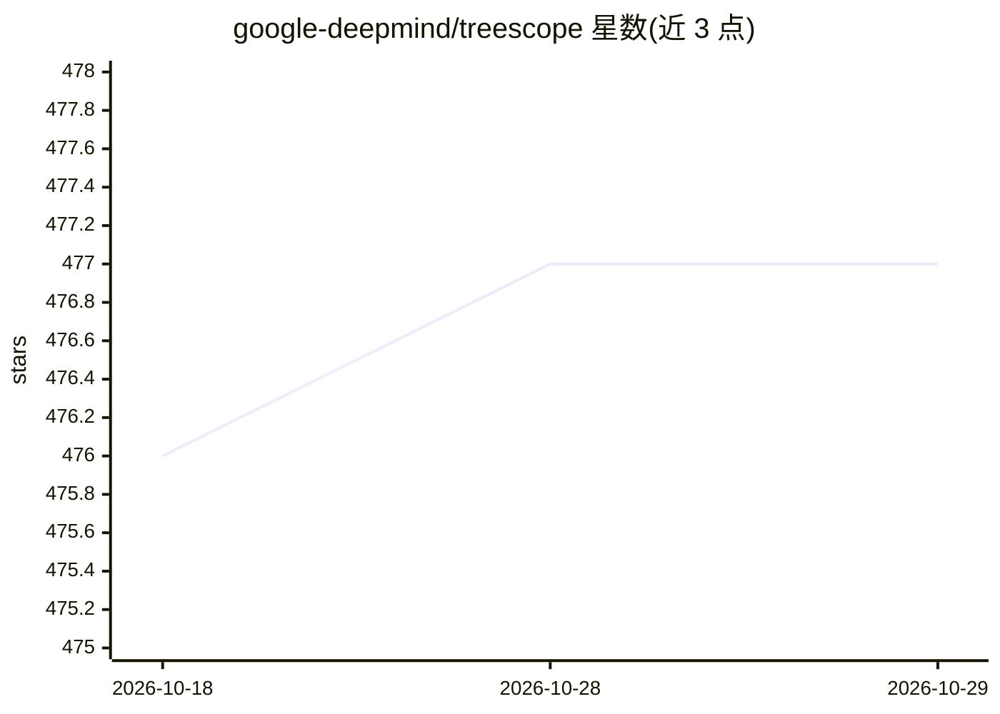

# google-deepmind/treescope

⭐ 477 · Python · Apache-2.0 · 推送 2026-06-18 · [GitHub](https://github.com/google-deepmind/treescope) · [官网](https://treescope.readthedocs.io/) · 组织维护

**面向 ML 研究的交互式 HTML 渲染与张量可视化工具**

IPython notebook 中的交互式 HTML pretty-printer 与 N 维数组（张量）可视化器，可替换标准 IPython/Colab 渲染器。功能包括展开/折叠渲染对象的子树、在输出中嵌入任意维数组的多面可视化、为神经网络共享结构着色、copy path 按钮与自定义渲染策略。最初为 Penzai 神经网络库开发，也支持渲染 Equinox、Flax NNX、PyTorch、JAX 和 Numpy 的模型与数据。通过 pip 安装，可用 treescope.show 或注册为默认渲染器。

## 筛选速览

| 维度 | 判定 | 备注 |
|---|---|---|
| AI 角色 | `ai-ecosystem` | LLM/agent 周边工具 |
| 许可风险 | `permissive` | Apache-2.0 |
| 部署形态 | `library` | 以包/库形式分发 |
| 模型依赖 | — | README 未给出锁定关系 |
| 硬件要求 | — | 无带数字的原话,不猜 |
| 安装摩擦 | `low` | 无编译、无系统依赖或容器化 |
| 成熟度 | — | 结构信号不足 |

## 能力要点

- 子树展开/折叠的交互式对象渲染
- 任意维数组/张量自动嵌入可视化（形状与数值分布）
- 神经网络共享结构色标与 copy path 按钮
- 支持渲染 Penzai/Equinox/Flax NNX/PyTorch/JAX/Numpy 对象

## 适用场景

- 在 notebook 中检查神经网络参数结构与数值分布
- 调试张量形状与数据内容
- 配置为默认渲染器替代 IPython/Colab 原生输出

## 场景标签

 · 领域:机器学习研究工具/可视化

## 证据(README 行号)

> L3: Treescope is an interactive HTML pretty-printer and N-dimensional array
> L4: ("tensor") visualizer, designed for machine learning and neural networks
> L5: research in IPython notebooks. It's a drop-in replacement for the standard

## 星数曲线

2026-10-18 476 → 2026-10-29 477（+1）

---
*卡片 v1 · prompt 1.4 · 生成 2026-10-21 · 置信度 high · 依据 README sha `639211d54c1e` · [字段定义](../../DATASET.md)*
