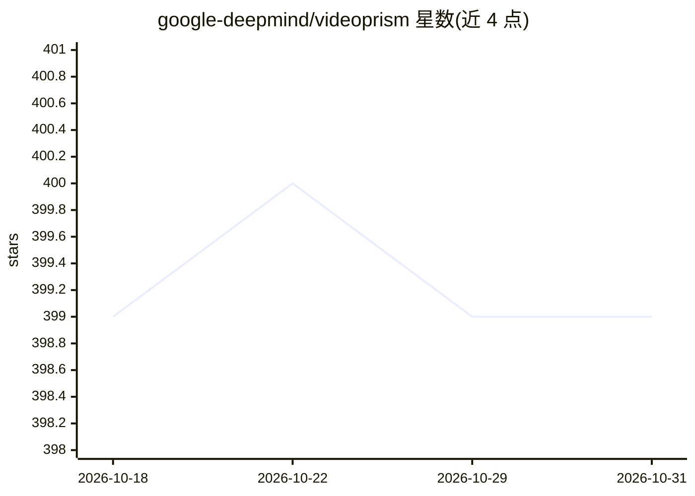

# google-deepmind/videoprism

⭐ 399 · Python · Apache-2.0 · 推送 2026-10-20 · [GitHub](https://github.com/google-deepmind/videoprism) · [官网](https://arxiv.org/abs/2402.13217) · 组织维护

**通用视频基础编码器：为分类、检索、问答等视频理解任务提供嵌入**

DeepMind 发布的视频基础模型仓库，提供 VideoPrism 视频/视频-文本编码器的预训练权重（Base/Large 共 4 个变体，114M-580M 参数）及 JAX/Flax 的检查点加载与推理工具函数。模型在 10 亿图文对与 6,180 万视频-文本对等数据上预训练，输出视频时空表征嵌入，可用于分类、检索、字幕生成、问答等任务；支持冻结骨干加轻量头微调与零样本视频-文本检索。以 pip 安装的 Python 包及 Colab notebook 形式提供；PyTorch 支持列于 TODO 尚未实现。

## 筛选速览

| 维度 | 判定 | 备注 |
|---|---|---|
| AI 角色 | `ai-native` | 本体是模型或模型工具 |
| 许可风险 | `permissive` | Apache-2.0 |
| 部署形态 | `library` | 以包/库形式分发 |
| 模型依赖 | — | README 未给出锁定关系 |
| 硬件要求 | — | 无带数字的原话,不猜 |
| 安装摩擦 | `low` | 无编译、无系统依赖或容器化 |
| 成熟度 | — | 结构信号不足 |

## 能力要点

- 发布 4 个模型变体（视频编码器与视频-文本编码器，ViT-B/ViT-L）
- 在 33 个公开视频理解基准中的 31 个上报告 SOTA（单一冻结模型）
- JAX/Flax 检查点加载与推理工具，支持任意帧数的时间位置插值
- 提供分类微调、检索等 4 个 Colab notebook 与 HuggingFace 模型

## 适用场景

- 为下游视频分类/检索任务提取视频嵌入特征
- 零样本视频-文本跨模态检索
- 冻结骨干微调轻量头做视频分类

## 场景标签

`多模态` · 领域:感知与多模态

## 证据(README 行号)

> L11: VideoPrism is a general-purpose video
> L23: This repository releases the model weight checkpoints and hosts JAX/Flax utility

## 星数曲线

2026-10-18 399 → 2026-10-31 399（+0）

---
*卡片 v1 · prompt 1.4 · 生成 2026-10-21 · 置信度 high · 依据 README sha `53f3a7ce743d` · [字段定义](../../DATASET.md)*
