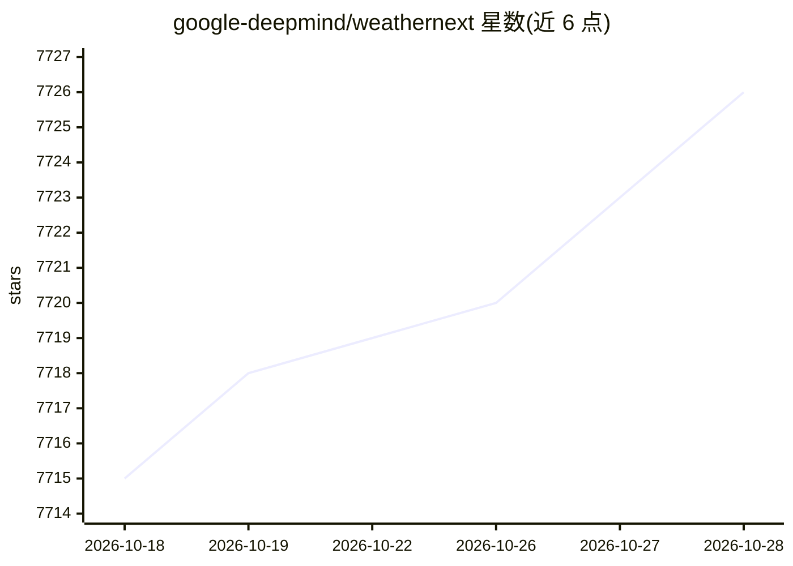

# google-deepmind/weathernext

⭐ 7,725 · Python · Apache-2.0 · 推送 2026-09-04 · [GitHub](https://github.com/google-deepmind/weathernext) · 组织维护

**Google DeepMind 的全球中期大气与气旋 AI 预报模型代码库**

提供 WeatherNext 2（WN2）及 WeatherNext Cyclones 的预训练模型权重与运行代码，输出全球中期大气预报与热带气旋路径预测；同库托管前身模型 GraphCast（确定性图神经网络）与 GenCast（扩散集合预报）。以 JAX 实现，推荐在 TPU 上运行，非 Mini 模型需 H100 GPU；提供 Colab 快速上手笔记本，权重与样例数据存于 Google Cloud Bucket。代码为研究性质 as-is 提供，不保证 API 稳定，模型输出不代表任何官方气象机构预警。

## 筛选速览

| 维度 | 判定 | 备注 |
|---|---|---|
| AI 角色 | `ai-native` | 本体是模型或模型工具 |
| 许可风险 | `permissive` | Apache-2.0 |
| 部署形态 | `library` | 以包/库形式分发 |
| 模型依赖 | — | README 未给出锁定关系 |
| 硬件要求 | — | 无带数字的原话,不猜 |
| 安装摩擦 | `low` | 无编译、无系统依赖或容器化 |
| 成熟度 | `idea` | |

## 能力要点

- WN2 在 0.25° 分辨率下输出中期大气预报，含 100m 风与气旋路径
- 提供多代预训练权重（2023/2024/2025 版本）及低算力 Mini 版本（1° 分辨率）
- Colab 笔记本演示权重加载、自回归 rollout、可视化与气旋追踪全流程
- 训练数据基于 ERA5/HRES（经 WeatherBench2 以 Zarr 提供）

## 适用场景

- 运行预训练模型生成全球中期天气预报
- 复现 WeatherNext Cyclones 论文中的气旋预报结果
- 基于模型输出研究热带气旋路径预测
- 在低算力环境（单 GPU/TPU）用 Mini 版本做本地测试

## 场景标签

 · 领域:气象/地球科学 AI 预报

## 证据(README 行号)

> L5: This repo contains the code for WeatherNext 2 (WN2), the global, medium-range
> L6: atmospheric and cyclone forecasting model developed by Google DeepMind and
> L118: 4. Run auto-regressive rollout steps to generate a forecast prediction.

## 星数曲线

2026-10-18 7,715 → 2026-10-28 7,726（+11）

---
*卡片 v1 · prompt 1.4 · 生成 2026-10-20 · 置信度 mid · 依据 README sha `d44cd2e1e722` · [字段定义](../../DATASET.md)*
