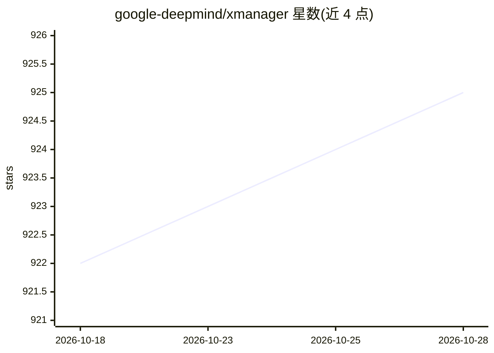

# google-deepmind/xmanager

⭐ 925 · Python · Apache-2.0 · 推送 2026-10-23 · [GitHub](https://github.com/google-deepmind/xmanager) · 组织维护

**给 ML 研究者：打包、运行与追踪机器学习实验的框架**

DeepMind 的机器学习实验管理平台：通过 Python launch 脚本调用 XManager API，定义可执行规格（容器、二进制、Python 模块）与执行器（本地、Vertex AI、Kubernetes），支持超参数网格展开、Job/JobGroup 调度与命令行参数传递，可在本地或 GCP 上启动并追踪实验。本仓库仅含客户端代码，不含服务端/UI。要求 Python 3.10+；Docker、Bazel、GCP 项目为可选前置。以 pip/PyPI 安装，xmanager launch 命令运行。

## 筛选速览

| 维度 | 判定 | 备注 |
|---|---|---|
| AI 角色 | `ai-ecosystem` | LLM/agent 周边工具 |
| 许可风险 | `permissive` | Apache-2.0 |
| 部署形态 | `library` | 以包/库形式分发 |
| 模型依赖 | — | README 未给出锁定关系 |
| 硬件要求 | — | 无带数字的原话,不猜 |
| 安装摩擦 | `low` | 无编译、无系统依赖或容器化 |
| 成熟度 | — | 结构信号不足 |

## 能力要点

- Python launch 脚本式 API 定义与启动实验
- 执行器支持本地、Vertex AI、Kubernetes
- JobGroup 提供组内同时调度的 gang scheduling
- 超参数以笛卡尔积展开生成多 trial 实验

## 适用场景

- 在本地或 GCP 上批量启动并追踪 ML 实验
- 用网格超参数跑多 trial 对比实验
- 将容器化训练任务提交到 Vertex AI 或 Kubernetes

## 场景标签

`MLOps` · 领域:训练与推理

## 证据(README 行号)

> L8: XManager is a platform for packaging, running and keeping track of machine
> L9: learning experiments. It currently enables one to launch experiments locally or
> L231: XManager executors define a platform where the job runs and resource

## 星数曲线

2026-10-18 922 → 2026-10-28 925（+3）

---
*卡片 v1 · prompt 1.4 · 生成 2026-10-21 · 置信度 high · 依据 README sha `1c6aed6592c5` · [字段定义](../../DATASET.md)*
