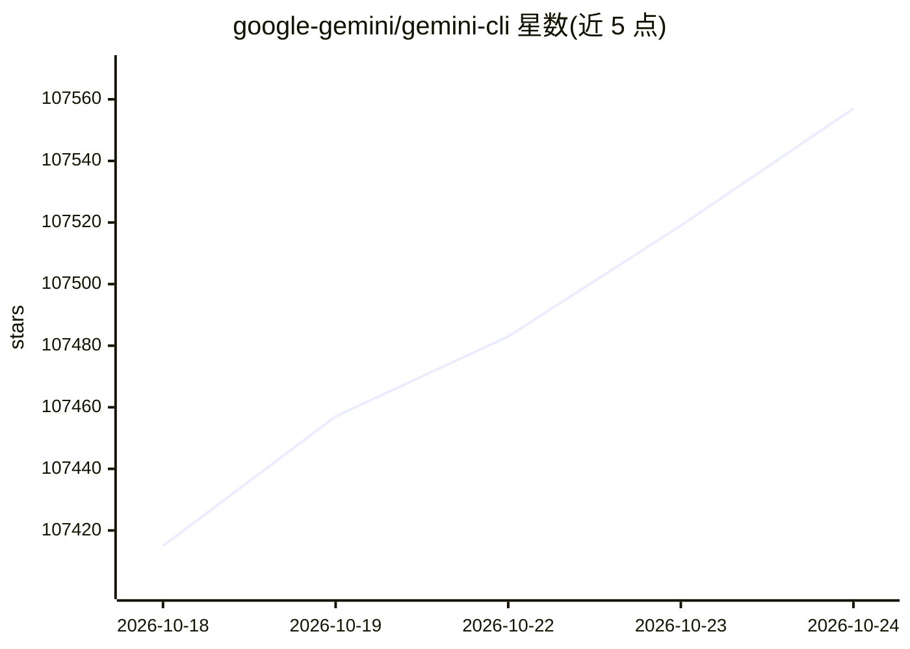

# google-gemini/gemini-cli

⭐ 107,788 · TypeScript · Apache-2.0 · 推送 2026-10-24 · [GitHub](https://github.com/google-gemini/gemini-cli) · [官网](https://geminicli.com) · 组织维护

**在终端中使用 Gemini 模型的开源 AI agent CLI**

Google 发布的开源命令行 AI agent，将 Gemini 模型接入终端：支持查询与编辑代码库、从 PDF/图片/草图生成应用、自然语言调试、以脚本方式非交互运行并输出 JSON/流式 JSON。通过 OAuth 登录、Gemini API Key 或 Vertex AI 三种方式认证，支持 MCP server 扩展工具、GEMINI.md 上下文文件、检查点、令牌缓存与沙箱执行。经 npm/brew/MacPorts 安装，提供 preview/stable/nightly 三个发布通道。README 注明免费层与 Google One 用户已被 Antigravity CLI 取代。

## 筛选速览

| 维度 | 判定 | 备注 |
|---|---|---|
| AI 角色 | `ai-native` | 本体是模型或模型工具 |
| 许可风险 | `permissive` | Apache-2.0 |
| 部署形态 | `library` | 以包/库形式分发 |
| 模型依赖 | — | README 未给出锁定关系 |
| 硬件要求 | — | 无带数字的原话,不猜 |
| 安装摩擦 | `low` | 无编译、无系统依赖或容器化 |
| 成熟度 | — | 结构信号不足 |

## 动量与使用信号

- 维护:`active` — 距上次 push 1.3 天,年发版 100,443 位贡献者
- 涨星:近 1 天 **+20**(自 20261016 起算)
- 安装:npm 包 `@google/gemini-cli` 月下载 1,647,448
- 平台:MACOS / LINUX · 协议:MCP

## 能力要点

- 三种认证方式：Google OAuth、Gemini API Key、Vertex AI
- MCP server 集成以扩展自定义工具（含 Imagen/Veo/Lyria 媒体生成）
- 非交互脚本模式，支持 JSON 与 stream-json 输出
- preview/stable/nightly 三个发布通道

## 适用场景

- 在终端里用自然语言查询和编辑大型代码库
- 将 Gemini 调用嵌入 shell 脚本做工作流自动化
- 配置 MCP server 连接 GitHub/Slack/数据库等工具
- 企业环境通过 Vertex AI 接入生产工作负载

## 场景标签

`编码 Agent` `AI 助手` · 领域:编码与开发

## 证据(README 行号)

> L24: Gemini CLI is an open-source AI agent that brings the power of Gemini directly
> L124: ## 🔐 Authentication Options
> L308: Configure MCP servers in `~/.gemini/settings.json` to extend Gemini CLI with

## 星数曲线

2026-10-18 107,415 → 2026-10-24 107,557（+142）

---
*卡片 v1 · prompt 1.4 · 生成 2026-10-18 · 置信度 high · 依据 README sha `93eb1a1bd648` · [字段定义](../../DATASET.md)*
