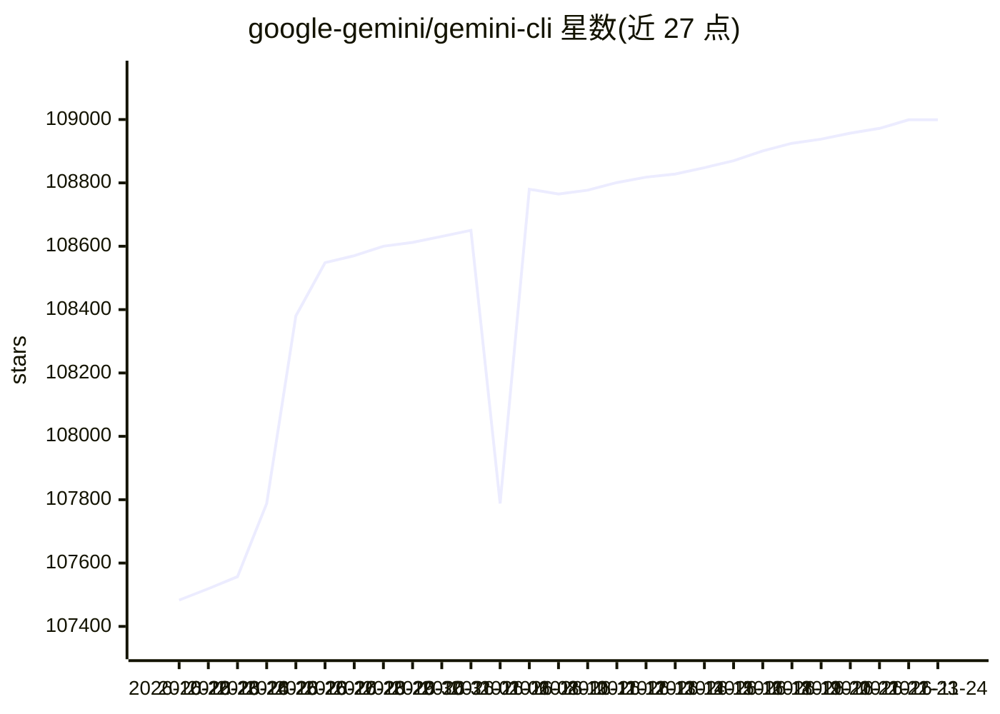

# google-gemini/gemini-cli

⭐ 108,999 · TypeScript · Apache-2.0 · 推送 2026-11-22 · [GitHub](https://github.com/google-gemini/gemini-cli) · [官网](https://geminicli.com) · 组织维护

**面向企业与开发者的 Gemini 终端 AI 代理 CLI**

开源终端代理，将 Gemini 模型接入命令行工作流，现主要面向持有 Gemini Code Assist Standard/Enterprise 许可的组织。功能覆盖大型代码库的查询与编辑、从 PDF/图像/草图生成应用、自然语言调试、PR 查询等运维任务自动化；通过 MCP 服务器扩展工具（含 Imagen/Veo/Lyria 媒体生成），支持脚本化非交互运行、JSON/流式输出、三种认证方式（Google OAuth、API Key、Vertex AI）与 preview/stable/nightly 发布通道。README 注明未针对 Gemini 4+ 调优，免费个人渠道已迁移至 Antigravity CLI。

## 筛选速览

| 维度 | 判定 | 备注 |
|---|---|---|
| AI 角色 | `ai-ecosystem` | LLM/agent 周边工具 |
| 许可风险 | `permissive` | Apache-2.0 |
| 部署形态 | `library` | 以包/库形式分发 |
| 模型依赖 | — | README 未给出锁定关系 |
| 硬件要求 | — | 无带数字的原话,不猜 |
| 安装摩擦 | `low` | 无编译、无系统依赖或容器化 |
| 成熟度 | — | 结构信号不足 |

## 动量与使用信号

- 维护:`active` — 距上次 push 1.3 天,年发版 100,443 位贡献者
- 涨星:近 1 天 **+20**(自 20261016 起算)
- 安装:npm 包 `@google/gemini-cli` 月下载 1,647,448
- 平台:MACOS / LINUX · 协议:MCP

## 能力要点

- npx/npm/brew/MacPorts/conda 多渠道安装，含 preview/stable/nightly 发布通道
- 三种认证方式：Google OAuth、Gemini API Key、Vertex AI
- MCP 服务器集成扩展自定义工具与媒体生成能力
- 非交互模式支持 JSON 与 stream-json 输出用于脚本自动化

## 适用场景

- 在终端里用自然语言查询、编辑和总结大型代码库
- 脚本与 CI 中非交互调用模型完成自动化任务
- 企业通过 Code Assist 许可统一管理团队的 AI 编码接入
- 通过 MCP 服务器接入内部数据库、Slack 等工具

## 场景标签

`编码 Agent` `AI 助手` · 领域:编码与开发

## 证据(README 行号)

> L25: Gemini CLI (`gemini`) is an open-source terminal agent maintained for enterprise
> L119: - Use MCP servers to connect new capabilities, including
> L123: ## 🔐 Authentication Options

## 星数曲线

2026-10-22 107,483 → 2026-11-24 108,999（+1,516）

---
*卡片 v1 · prompt 1.4 · 生成 2026-11-22 · 置信度 high · 依据 README sha `cf5be476279e` · [字段定义](../../DATASET.md)*
