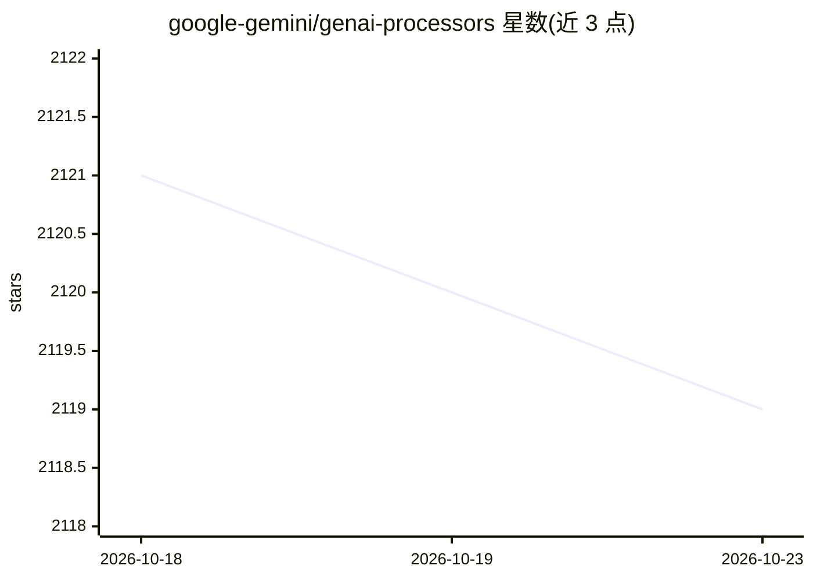

# google-gemini/genai-processors

⭐ 2,119 · Python · Apache-2.0 · 推送 2026-10-15 · [GitHub](https://github.com/google-gemini/genai-processors) · [官网](https://google-gemini.github.io/genai-processors/) · 组织维护

**开发者用 Python 库：构建模块化异步多模态 LLM 处理管线**

Google Gemini 团队维护的轻量 Python 库，用于构建模块化、异步、可组合的生成式 AI 内容处理管线。核心抽象为 Processor，通过 dual-interface 模式封装异步多模态流式处理，支持用 + 链接、// 并行组合。内置 GenaiModel（turn-based API 调用）与 LiveProcessor（实时流式交互）等处理器，统一内容模型 ProcessorPart 可承载文本、图像、音频与自定义 JSON。要求 Python 3.10+，pip 安装，附带 Colab 教程与实时语音 Agent、研究 Agent 等示例。面向使用 Gemini API 的开发者。

## 筛选速览

| 维度 | 判定 | 备注 |
|---|---|---|
| AI 角色 | `ai-ecosystem` | LLM/agent 周边工具 |
| 许可风险 | `permissive` | Apache-2.0 |
| 部署形态 | `library` | 以包/库形式分发 |
| 模型依赖 | — | README 未给出锁定关系 |
| 硬件要求 | — | 无带数字的原话,不猜 |
| 安装摩擦 | `low` | 无编译、无系统依赖或容器化 |
| 成熟度 | — | 结构信号不足 |

## 能力要点

- Processor 抽象：支持链接（+）与并行（//）组合，基于 asyncio
- 内置 GenaiModel 与 LiveProcessor 处理器（turn-based 与实时流式）
- ProcessorPart 统一内容模型，支持文本/图像/音频/自定义 JSON
- 提供异步流的拆分、拼接与合并工具

## 适用场景

- 构建基于 Gemini API 的 turn-based 或实时多模态 Agent
- 将多步 LLM 内容变换组织为可组合的异步管线
- 参考示例实现语音输入输出的实时 Live Agent

## 场景标签

`多模态` `Agent 框架` · 领域:Agent 开发

## 证据(README 行号)

> L9: GenAI Processors is a lightweight Python library that enables efficient,
> L51: * **Integrated with GenAI API**: Includes ready-to-use processors like
> L52:  `GenaiModel` for turn-based API calls and `LiveProcessor` for real-time

## 星数曲线

2026-10-18 2,121 → 2026-10-23 2,119（-2）

---
*卡片 v1 · prompt 1.4 · 生成 2026-10-21 · 置信度 high · 依据 README sha `6e19c9d702ff` · [字段定义](../../DATASET.md)*
