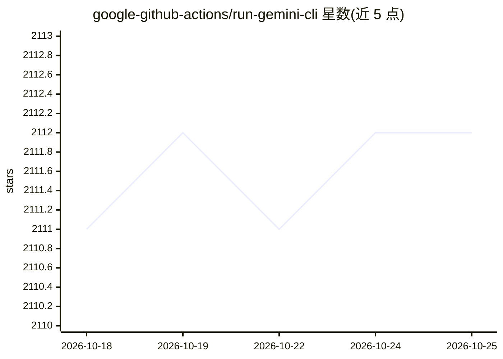

# google-github-actions/run-gemini-cli

⭐ 2,113 · TypeScript · Apache-2.0 · 推送 2026-08-21 · [GitHub](https://github.com/google-github-actions/run-gemini-cli) · [官网](https://github.com/google-gemini/gemini-cli) · 组织维护

**在 GitHub 仓库中调用 Gemini CLI 的 GitHub Action**

由 Google 维护的 GitHub Action，将 Gemini CLI 接入 GitHub 工作流：支持按事件或定时触发，也可在 issue/PR 评论中通过 @gemini-cli 按需召唤，执行 PR 审查、issue 分类、代码分析与修改等任务。通过预构建工作流与集中调度器（dispatch）组织请求，用 GEMINI.md 提供项目级指令。认证支持 Gemini API Key、Workload Identity Federation 与 Vertex AI/Code Assist 可选通道；可将遥测数据发送到用户自己的 GCP 项目做可观测性。

## 筛选速览

| 维度 | 判定 | 备注 |
|---|---|---|
| AI 角色 | `ai-ecosystem` | LLM/agent 周边工具 |
| 许可风险 | `permissive` | Apache-2.0 |
| 部署形态 | `library` | 以包/库形式分发 |
| 模型依赖 | — | README 未给出锁定关系 |
| 硬件要求 | — | 无带数字的原话,不猜 |
| 安装摩擦 | `low` | 无编译、无系统依赖或容器化 |
| 成熟度 | — | 结构信号不足 |

## 能力要点

- 事件/定时自动触发与 @gemini-cli 评论按需触发两种模式
- 预置 dispatch/issue 分诊/PR 审查/通用助手等工作流
- 支持 Gemini API Key、Vertex AI、Code Assist 与 Workload Identity Federation 多种认证
- GEMINI.md 提供项目级指令，遥测可发送到自有 GCP 项目

## 适用场景

- 打开 PR 时自动进行代码审查
- 自动分诊和整理 GitHub issue
- 在 issue/PR 评论中让 Gemini 代写单测、调试、解释代码

## 场景标签

`代码审查` `工作流自动化` `编码 Agent` · 领域:效率与自动化

## 证据(README 行号)

> L5: `run-gemini-cli` is a GitHub Action that integrates [Gemini] into your development workflow via the [Gemini CLI]. It
> L7: Use it to perform GitHub pull request reviews, triage issues, perform code analysis and modification, and more using
> L118: This type of action can be used to invoke a general-purpose, conversational Gemini

## 星数曲线

2026-10-18 2,111 → 2026-10-25 2,112（+1）

---
*卡片 v1 · prompt 1.4 · 生成 2026-10-21 · 置信度 mid · 依据 README sha `8cad0d281d69` · [字段定义](../../DATASET.md)*
