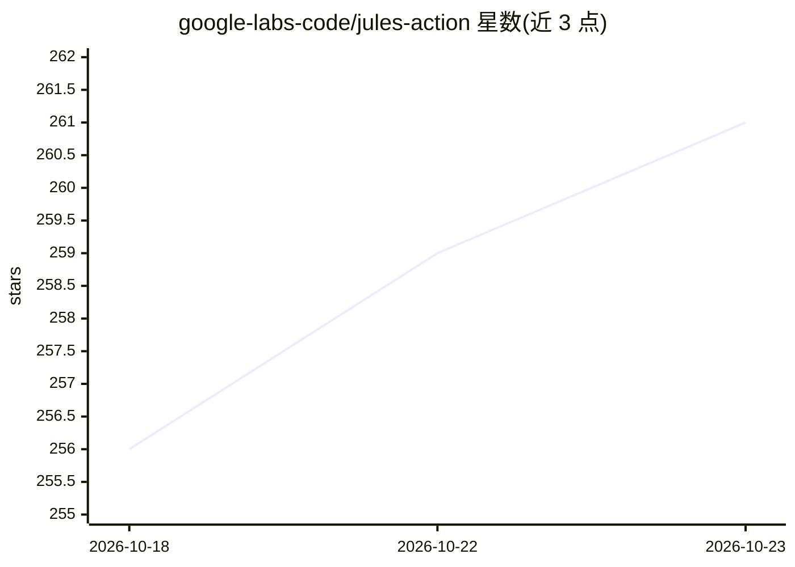

# google-labs-code/jules-action

⭐ 261 · MIT · 推送 2025-12-15 · [GitHub](https://github.com/google-labs-code/jules-action) · [官网](https://jules.google) · 组织维护

**在 GitHub 工作流中调用 Jules 云端编码 Agent 的 Action**

由 Google Labs 维护的 GitHub Action：通过 issue、PR、定时任务或手动触发等 GitHub 事件，调用 Jules 远程 AI 编码 Agent（由 Gemini 3 Pro 驱动，运行于云端 VM），执行修 bug、性能优化、CI 失败修复、安全扫描等任务并创建 PR。使用需在 jules.google.com 生成 API key 并存入 GitHub Secrets；README 提示需用 allowlist 限制 issue 触发者以防范不可信用户，并要求合并前审查 Jules 的 PR。

## 筛选速览

| 维度 | 判定 | 备注 |
|---|---|---|
| AI 角色 | `ai-ecosystem` | LLM/agent 周边工具 |
| 许可风险 | `permissive` | MIT |
| 部署形态 | `None` |  |
| 模型依赖 | — | README 未给出锁定关系 |
| 硬件要求 | — | 无带数字的原话,不猜 |
| 安装摩擦 | `low` | 无编译、无系统依赖或容器化 |
| 成熟度 | — | 结构信号不足 |

## 能力要点

- 从任意 GitHub 事件（issue/PR/定时/手动）触发 Jules
- 提供 5 个示例工作流：清理、性能、修 bug、CI 修复、解除阻塞 issue
- 支持指定起始分支、附带 diff 与提交历史的上下文输入
- 安全建议：API key 走 Secrets、issue 触发加用户白名单

## 适用场景

- 定时运行安全扫描与依赖更新等自动维护任务
- issue 打标后自动诊断并修复 bug 生成 PR
- CI 失败时自动修复构建错误

## 场景标签

`编码 Agent` · 领域:编码与开发

## 证据(README 行号)

> L12: **Jules** is a remote AI coding agent from Google Labs powered by Gemini 3 Pro. It works autonomously in a cloud VM
> L14: **This action** lets you trigger Jules from any GitHub event: issues, pull requests, schedules, or workflow dispatc

## 星数曲线

2026-10-18 256 → 2026-10-23 261（+5）

---
*卡片 v1 · prompt 1.4 · 生成 2026-10-22 · 置信度 high · 依据 README sha `c34d75b527ec` · [字段定义](../../DATASET.md)*
