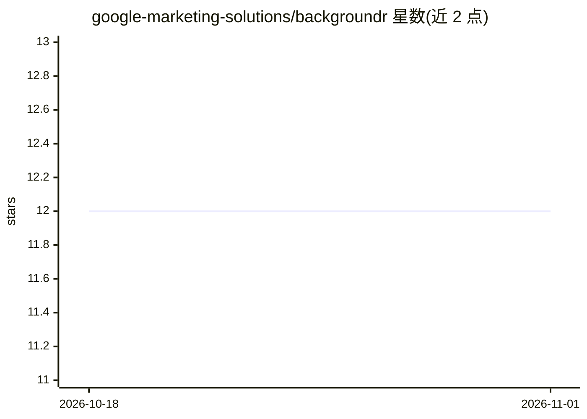

# google-marketing-solutions/backgroundr

⭐ 12 · TypeScript · Apache-2.0 · 推送 2026-09-15 · [GitHub](https://github.com/google-marketing-solutions/backgroundr) · 组织维护

**Google Sheets 插件：用 Nano Banana 批量 AI 编辑商品图片**

面向营销素材团队的 Google Sheets 附加组件，通过 Google 的 Nano Banana（gemini-2.5-flash-image）在表格内批量生成图片变体、外绘与叠加素材，原始与生成图片经 Google Drive 文件夹同步。支持自定义 prompt 前后缀、多变体组合表，及由 Gemini 评分模型驱动的质量阈值检查与自动重生成循环。运行需自备启用了 Gemini Enterprise Agent Platform（原 Vertex AI）API 的 GCP 项目；单文件上限 30MB。开发者可经 npm 与 Clasp 自行构建部署（Angular 19 前端 + Apps Script 后端）。

## 筛选速览

| 维度 | 判定 | 备注 |
|---|---|---|
| AI 角色 | `ai-native` | 本体是模型或模型工具 |
| 许可风险 | `permissive` | Apache-2.0 |
| 部署形态 | `library` | 以包/库形式分发 |
| 模型依赖 | — | README 未给出锁定关系 |
| 硬件要求 | — | 无带数字的原话,不猜 |
| 安装摩擦 | `low` | 无编译、无系统依赖或容器化 |
| 成熟度 | — | 结构信号不足 |

## 能力要点

- Nano Banana 模型在 Sheets 内批量生成图片变体与外绘
- Google Drive 文件夹作为素材输入输出源
- Gemini 评分模型按阈值自动重生成直至达标或达上限
- prompt 前后缀配置以对齐品牌风格

## 适用场景

- 营销团队批量生成符合品牌规范的商品图变体
- 在表格中定义文案与素材组合后一键批量出图
- 自动质检生成的广告素材并重生成不达标图片

## 场景标签

`图像生成` · 领域:内容生成

## 证据(README 行号)

> L11: **BackgroundR 2.0** leverages Google's **Nano Banana** model for comprehensive AI image editing. Far beyond simple 
> L13: Built as an elegant, web-native Google Sheets Add-on, BackgroundR lets you process images in bulk directly from Goo

## 星数曲线

2026-10-18 12 → 2026-11-01 12（+0）

---
*卡片 v1 · prompt 1.4 · 生成 2026-11-01 · 置信度 high · 依据 README sha `505e13906144` · [字段定义](../../DATASET.md)*
