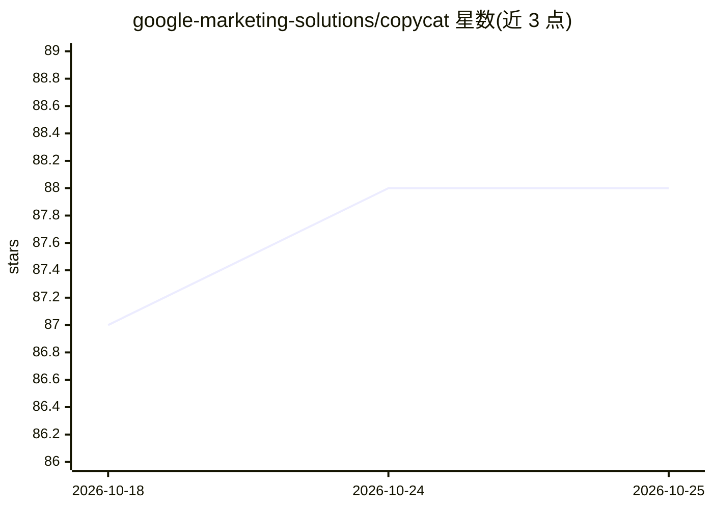

# google-marketing-solutions/copycat

⭐ 88 · Python · Apache-2.0 · 推送 2026-09-24 · [GitHub](https://github.com/google-marketing-solutions/copycat) · 组织维护

**用 Gemini 按品牌风格批量生成 Google 搜索广告文案的 Python 工具**

Google Marketing Solutions 下的 Python 包：读取 Google Ads 账户中已有的优质搜索广告（标题、描述、关键词），用 Affinity Propagation 选取代表性样例广告，再由 Gemini 生成品牌风格指南，随后为新关键词批量生成标题与描述，并可补全现有广告的空位。提供 Colab UI、Python 示例笔记本和 Google Sheets 部署三种使用方式。需要启用 Vertex AI API 的 Google Cloud 项目，使用会产生费用；README 提示生成文案需人工审核。

## 筛选速览

| 维度 | 判定 | 备注 |
|---|---|---|
| AI 角色 | `ai-native` | 本体是模型或模型工具 |
| 许可风险 | `permissive` | Apache-2.0 |
| 部署形态 | `library` | 以包/库形式分发 |
| 模型依赖 | — | README 未给出锁定关系 |
| 硬件要求 | — | 无带数字的原话,不猜 |
| 安装摩擦 | `low` | 无编译、无系统依赖或容器化 |
| 成熟度 | — | 结构信号不足 |

## 能力要点

- 从既有广告学习品牌风格并生成新广告文案
- Affinity Propagation 压缩训练广告为代表性样例
- 生成结果的记忆化检查、风格与关键词相似度评估
- 支持 PDF 品牌指南融入风格指南生成

## 适用场景

- 为新出现的关键词快速生成符合品牌语气的搜索广告
- 批量补全现有 Responsive Search Ads 的空标题/描述位
- 品牌语气调整后大规模重写现有广告

## 场景标签

`AI 写作` · 领域:内容生成

## 证据(README 行号)

> L24: Copycat is a Python package that leverages Google Gemini models to generate high-quality ad copies for Google Searc
> L73: 4. **New Ad Generation:** Provide new keywords (or keywords from existing ad groups) for which you want to generate

## 星数曲线

2026-10-18 87 → 2026-10-25 88（+1）

---
*卡片 v1 · prompt 1.4 · 生成 2026-10-23 · 置信度 high · 依据 README sha `9a8c1080d24e` · [字段定义](../../DATASET.md)*
