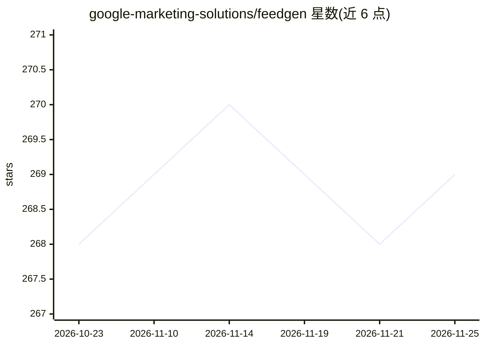

# google-marketing-solutions/feedgen

⭐ 269 · TypeScript · Apache-2.0 · 推送 2026-11-16 · [GitHub](https://github.com/google-marketing-solutions/feedgen) · 组织维护

**给电商商家用生成式 AI 优化 Shopping 商品标题与描述**

基于 Google Apps Script、运行在 Google Sheets 侧边栏的开源工具，通过 GCP Vertex AI 的基础 LLM 改写商品标题、生成描述并补全缺失属性，支持 zero-shot 与 few-shot（用自有 feed 中 3-10 条样本定制输出）。提供生成内容的评分校验、人工逐条/批量审批、错误自动重生成，并可将结果作为补充 feed 接回 Merchant Center。支持读取商品落地页内容辅助生成；规模上限约 3 万条商品。

## 筛选速览

| 维度 | 判定 | 备注 |
|---|---|---|
| AI 角色 | `ai-native` | 本体是模型或模型工具 |
| 许可风险 | `permissive` | Apache-2.0 |
| 部署形态 | `library` | 以包/库形式分发 |
| 模型依赖 | locked-api |  |
| 硬件要求 | — | 无带数字的原话,不猜 |
| 安装摩擦 | `low` | 无编译、无系统依赖或容器化 |
| 成熟度 | `idea` | |

## 能力要点

- 在 Google Sheets 侧边栏内完成配置、生成与审批全流程
- few-shot 用自有 feed 样本定制模型输出，可结合微调
- 生成内容评分与批量审批（Approve Filtered）机制
- 读取商品落地页 HTML/JSON 内容辅助生成标题与描述

## 适用场景

- 批量修复 Merchant Center 里的商品标题/描述质量问题
- 补全商品 feed 中缺失的属性
- 用自有优质商品样本引导模型生成风格一致的内容

## 场景标签

 · 领域:电商/营销工具

## 证据(README 行号)

> L48: **FeedGen** is an open-source tool that uses Google Cloud's state-of-the-art
> L89: FeedGen is an Apps Script based application that runs as an HTML sidebar (see
> L54: The tool relies on GCP's Vertex AI API to provide both zero-shot and few-shot

## 星数曲线

2026-10-23 268 → 2026-11-25 269（+1）

---
*卡片 v1 · prompt 1.4 · 生成 2026-11-25 · 置信度 high · 依据 README sha `823f4371f999` · [字段定义](../../DATASET.md)*
