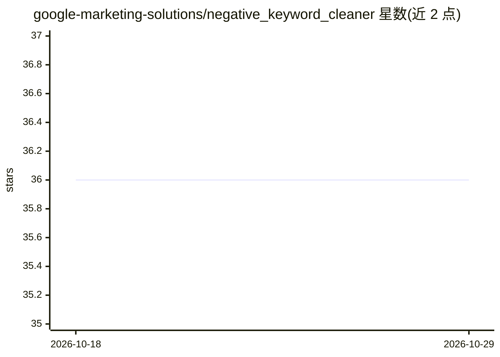

# google-marketing-solutions/negative_keyword_cleaner

⭐ 36 · Python · Apache-2.0 · 推送 2026-10-21 · [GitHub](https://github.com/google-marketing-solutions/negative_keyword_cleaner) · 组织维护

**用 LLM 识别并清理 Google Ads 账户中的否定关键词**

面向 Google Ads 投放者的 Web 应用：利用大语言模型分析账户，找出阻挡流量的否定关键词并协助移除。需自备 Google Ads 开发者令牌、GCP OAuth2 凭据与 Gemini API Key。部署路径为 Terraform + Cloud Run（Docker 镜像推 Artifact Registry），也可本地以 Streamlit 运行（要求 Python 3.11）。README 声明非官方支持产品、实验性质、按现状提供。

## 筛选速览

| 维度 | 判定 | 备注 |
|---|---|---|
| AI 角色 | `ai-native` | 本体是模型或模型工具 |
| 许可风险 | `permissive` | Apache-2.0 |
| 部署形态 | `desktop` | 安装包/桌面程序 |
| 模型依赖 | — | README 未给出锁定关系 |
| 硬件要求 | — | 无带数字的原话,不猜 |
| 安装摩擦 | `low` | 无编译、无系统依赖或容器化 |
| 成熟度 | `idea` | |

## 能力要点

- LLM 识别阻碍流量的否定关键词并协助移除
- Terraform 一键部署到 GCP Cloud Run，terraform destroy 一条命令卸载
- 支持本地 Streamlit 运行（需 Gemini API Key）

## 适用场景

- 排查 Google Ads 账户中误伤流量的否定关键词
- 投放团队批量清理否定关键词以恢复流量

## 场景标签

 · 领域:数字营销/广告工具

## 证据(README 行号)

> L5: Negative Keyword Cleaner is a solution that leverages Large Language Models to
> L6: identify and help you remove Negative Keywords blocking traffic from your

## 星数曲线

2026-10-18 36 → 2026-10-29 36（+0）

---
*卡片 v1 · prompt 1.4 · 生成 2026-10-25 · 置信度 mid · 依据 README sha `8edae2cfa713` · [字段定义](../../DATASET.md)*
