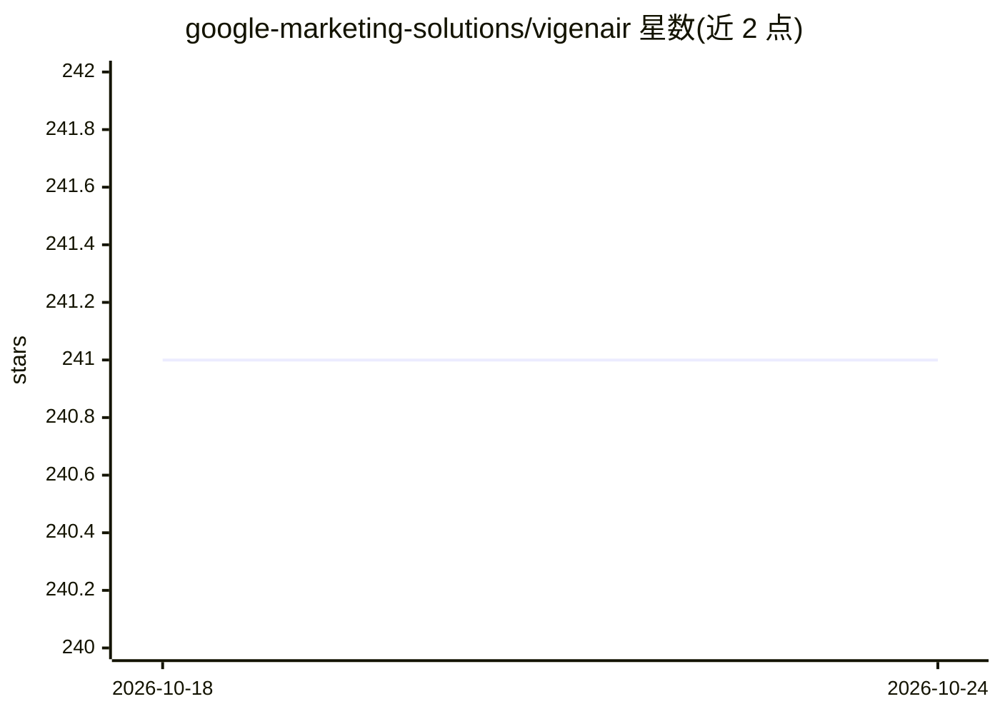

# google-marketing-solutions/vigenair

⭐ 241 · Python · Apache-2.0 · 推送 2026-10-15 · [GitHub](https://github.com/google-marketing-solutions/vigenair) · 组织维护

**用 Google Cloud 生成式 AI 将长视频广告改造为多格式短视频变体的 Web 应用**

部署在 GCP 上的 Web 应用，使用多模态生成式 AI（Gemini、Vertex AI）自动将长视频广告转换为多种格式（竖屏、方形等）与长度的短视频变体，面向不同受众；同时生成视频、图像与文本资产供 Demand Gen 与 YouTube 视频 campaigns 使用。通过 Cloud Shell 运行 npm start 脚本部署 Cloud Function 后端与 Angular UI（Apps Script），需要 GCP 项目与相应 IAM 角色；处理流程包括视频分段、Smart Framing 动态裁剪、ABCD 评估打分与转述文本编辑。

## 筛选速览

| 维度 | 判定 | 备注 |
|---|---|---|
| AI 角色 | `ai-native` | 本体是模型或模型工具 |
| 许可风险 | `permissive` | Apache-2.0 |
| 部署形态 | `library` | 以包/库形式分发 |
| 模型依赖 | — | README 未给出锁定关系 |
| 硬件要求 | — | 无带数字的原话,不猜 |
| 安装摩擦 | `low` | 无编译、无系统依赖或容器化 |
| 成熟度 | — | 结构信号不足 |

## 能力要点

- 长视频广告自动转换为多种格式与受众的短视频变体
- 同时生成视频、图像与文本资产供 Demand Gen / YouTube campaigns 使用
- Smart Framing 动态取景、ABCD 评估与自定义评分指南
- 支持 3:4/4:3 等多种宽高比、VTT 转录编辑与 Terraform 可选部署

## 适用场景

- 把长视频广告批量改成竖屏/方形等短视频变体投放
- 为 Demand Gen campaigns 自动产出图像与多语言文本资产
- 按 ABCD 最佳实践评估生成的视频变体并获得改进建议

## 场景标签

`视频生成` `图像生成` · 领域:内容生成

## 证据(README 行号)

> L75: **ViGenAiR** *(pronounced vision-air)* harnesses the power of multimodal Generative AI models on Google Cloud Platf
> L93:  * You will also be asked to specify a GCP region for Vertex AI access (defaults to `us-central1`).
> L112: * GCP project

## 星数曲线

2026-10-18 241 → 2026-10-24 241（+0）

---
*卡片 v1 · prompt 1.4 · 生成 2026-10-22 · 置信度 high · 依据 README sha `c738aa29cb52` · [字段定义](../../DATASET.md)*
