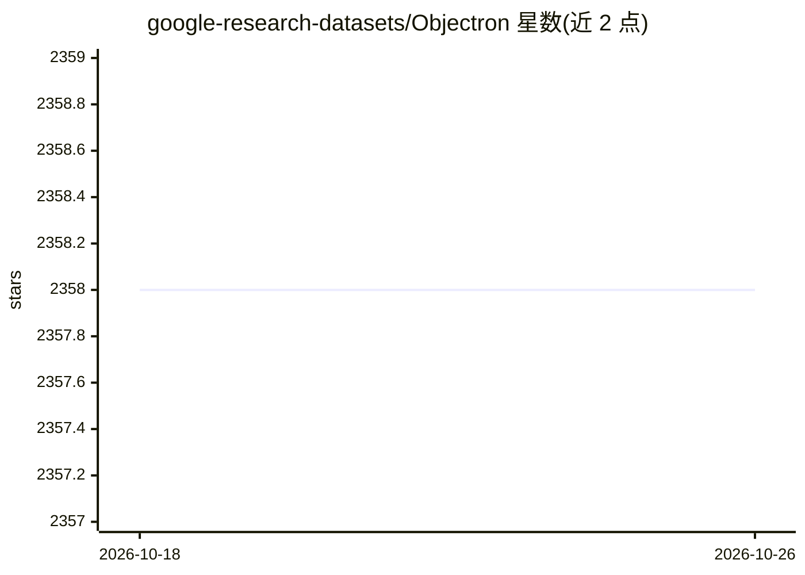

# google-research-datasets/Objectron

⭐ 2,358 · Jupyter Notebook · NOASSERTION · 推送 2026-03-06 · [GitHub](https://github.com/google-research-datasets/Objectron) · 组织维护

**面向 3D 视觉的物体中心视频数据集：含姿态标注与 AR 元数据**

Google Research 发布的物体中心短视频数据集：15K 视频、4M+ 标注图像，覆盖 9 个日用品类别，每帧含手工标注的 3D 边界盒、相机位姿、稀疏点云与平面表征；数据采自 5 大洲 10 国以保证地理多样性。仓库提供 protobuf schema、TensorFlow/PyTorch/JAX 加载脚本、3D IoU 评测脚本及 Apache Beam 处理作业，数据存于 Google Cloud Storage（总规模 4.4TB），并以 MediaPipe 形式分享 4 类物体的 3D 检测模型。许可为 C-UDA-1.0，非官方 Google 产品。

## 筛选速览

| 维度 | 判定 | 备注 |
|---|---|---|
| AI 角色 | `ai-knowledge` | 知识聚合/清单类 |
| 许可风险 | `none` | NOASSERTION |
| 部署形态 | `None` |  |
| 模型依赖 | — | README 未给出锁定关系 |
| 硬件要求 | — | 无带数字的原话,不猜 |
| 安装摩擦 | `low` | 无编译、无系统依赖或容器化 |
| 成熟度 | — | 结构信号不足 |

## 能力要点

- 15K 视频 / 4M 标注图像，含 3D 边界盒、相机位姿、点云与平面元数据
- 支持 TensorFlow / PyTorch / JAX 的加载与可视化示例脚本
- 基于 3D IoU（朝向 3D 边界盒）的评测脚本与 train/test 划分索引
- 附带在 MediaPipe 发布的 4 类物体 3D 检测模型

## 适用场景

- 训练与评测 3D 物体检测或位姿估计模型
- 利用多视角视频与位姿标注做 NeRF 等 3D 重建研究
- 按类别下载子集构建自定义训练管线

## 场景标签

 · 领域:计算机视觉/3D 数据集

## 证据(README 行号)

> L10: The Objectron dataset is a collection of short, object-centric video clips, which are accompanied by AR session met
> L13: - 15000 annotated videos and 4M annotated images

## 星数曲线

2026-10-18 2,358 → 2026-10-26 2,358（+0）

---
*卡片 v1 · prompt 1.4 · 生成 2026-10-21 · 置信度 high · 依据 README sha `19cf7a688578` · [字段定义](../../DATASET.md)*
