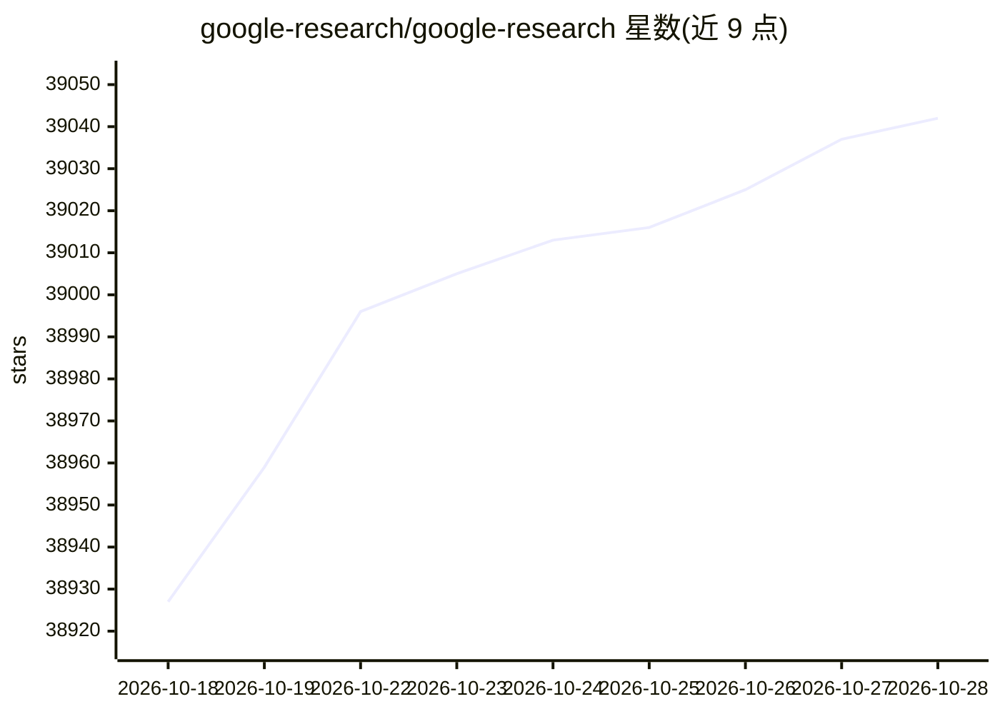

# google-research/google-research

⭐ 39,047 · Jupyter Notebook · Apache-2.0 · 推送 2026-10-28 · [GitHub](https://github.com/google-research/google-research) · [官网](https://research.google) · 组织维护

**Google Research 开源研究代码汇总仓库**

该仓库集中存放 Google Research 发布的研究代码，内容按子目录划分为多个独立项目，覆盖主题标签所列的 AI 与机器学习研究方向。仓库体量较大，README 建议仅下载感兴趣的子目录（可通过 github.dev 编辑器下载），或以浅克隆方式获取源码。数据集采用 CC BY 4.0 许可，源代码采用 Apache 2.0 许可，仓库声明非 Google 官方产品。

## 筛选速览

| 维度 | 判定 | 备注 |
|---|---|---|
| AI 角色 | `ai-ecosystem` | LLM/agent 周边工具 |
| 许可风险 | `dual` | Apache-2.0 |
| 部署形态 | `None` |  |
| 模型依赖 | — | README 未给出锁定关系 |
| 硬件要求 | — | 无带数字的原话,不猜 |
| 安装摩擦 | `low` | 无编译、无系统依赖或容器化 |
| 成熟度 | — | 结构信号不足 |

## 动量与使用信号

- 维护:`active` — 距上次 push 3.2 天,年发版 0,388 位贡献者
- 涨星:近 1 天 **+2**(自 20261016 起算)
- 安装:github 包 `release-assets` 月下载无数据

## 能力要点

- 集中托管 Google Research 发布的多个研究项目代码
- 数据集采用 CC BY 4.0，源代码采用 Apache 2.0 双许可结构
- 支持通过 github.dev 编辑器按子目录下载
- 提供浅克隆命令以减小下载体积

## 适用场景

- 按子目录下载感兴趣的研究项目代码
- 复现或查阅论文配套的开源实现
- 以浅克隆方式浏览仓库内容

## 场景标签

`精选清单` · 领域:学习与行业

## 证据(README 行号)

> L3: This repository contains code released by
> L12: Because the repo is large, we recommend you download only the subdirectory of

## 星数曲线

2026-10-18 38,927 → 2026-10-28 39,042（+115）

---
*卡片 v1 · prompt 1.4 · 生成 2026-10-18 · 置信度 mid · 依据 README sha `f21ce455a915` · [字段定义](../../DATASET.md)*
