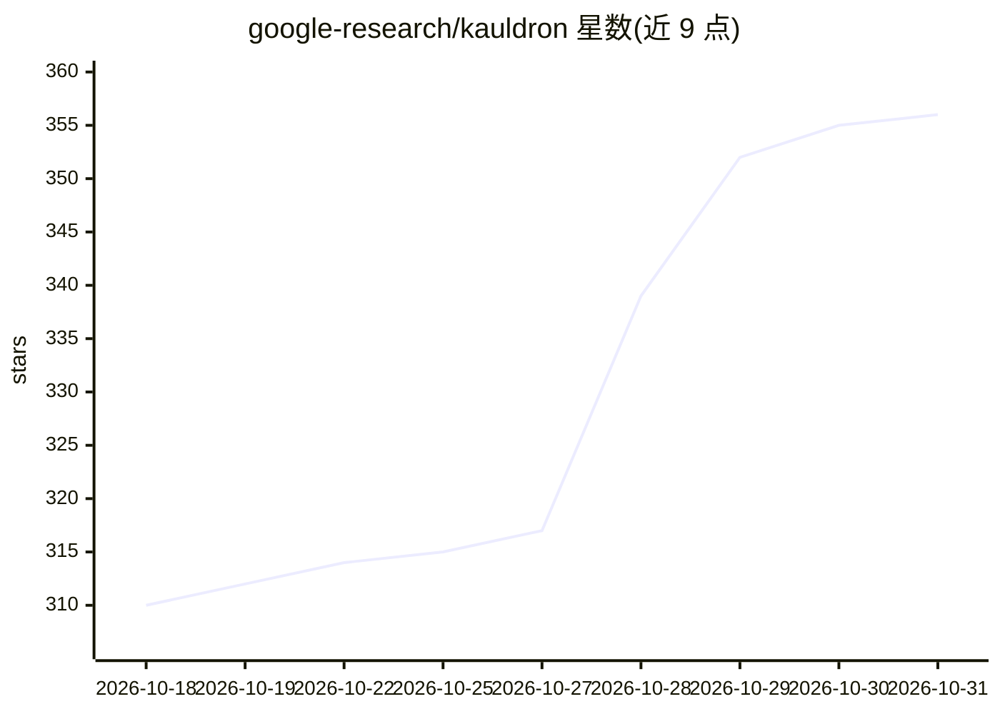

# google-research/kauldron

⭐ 356 · Python · Apache-2.0 · 推送 2026-10-30 · [GitHub](https://github.com/google-research/kauldron) · [官网](https://kauldron.readthedocs.io/) · 组织维护

**面向研究迭代速度与模块化的 JAX/Flax 模型训练库**

Google Research 维护的机器学习模型训练库，基于 JAX/Flax 生态，强调模块化与研究效率：各组件自包含可独立使用，支持任意数据集（TFDS、Grain、SeqIO、自定义管道）、任意 Flax 模型与优化器，提供将各部分连接的胶水层；一切均可自定义覆盖。开箱即用的示例配置、Colab 优先的原型工作流，以及集成 XM 绘图、profiler、事后调试、运行时形状检查等工具。以 Python 库形式发布在 PyPI。README 声明非 Google 官方支持产品。

## 筛选速览

| 维度 | 判定 | 备注 |
|---|---|---|
| AI 角色 | `ai-ecosystem` | LLM/agent 周边工具 |
| 许可风险 | `permissive` | Apache-2.0 |
| 部署形态 | `library` | 以包/库形式分发 |
| 模型依赖 | — | README 未给出锁定关系 |
| 硬件要求 | — | 无带数字的原话,不猜 |
| 安装摩擦 | `low` | 无编译、无系统依赖或容器化 |
| 成熟度 | — | 结构信号不足 |

## 能力要点

- 组件自包含，可独立于 Kauldron 使用
- 支持任意数据集（TFDS/Grain/SeqIO/自定义）、任意 Flax 模型与优化器
- 示例配置可直接使用并定制，Colab 优先的原型工作流
- 集成 profiler、运行时形状检查、事后调试等研究工具

## 适用场景

- 研究人员快速搭建与迭代模型训练实验
- 对模型架构、优化器做参数扫描与定制覆盖
- 在 Colab 中进行原型训练与可视化分析

## 场景标签

`模型训练` · 领域:训练与推理

## 证据(README 行号)

> L7: Kauldron is a library for training machine learning models, optimized for
> L15:  any (flax) model, any optimizer,... Kauldron provides the

## 星数曲线

2026-10-18 310 → 2026-10-31 356（+46）

---
*卡片 v1 · prompt 1.4 · 生成 2026-10-21 · 置信度 high · 依据 README sha `03415fe8a0cd` · [字段定义](../../DATASET.md)*
