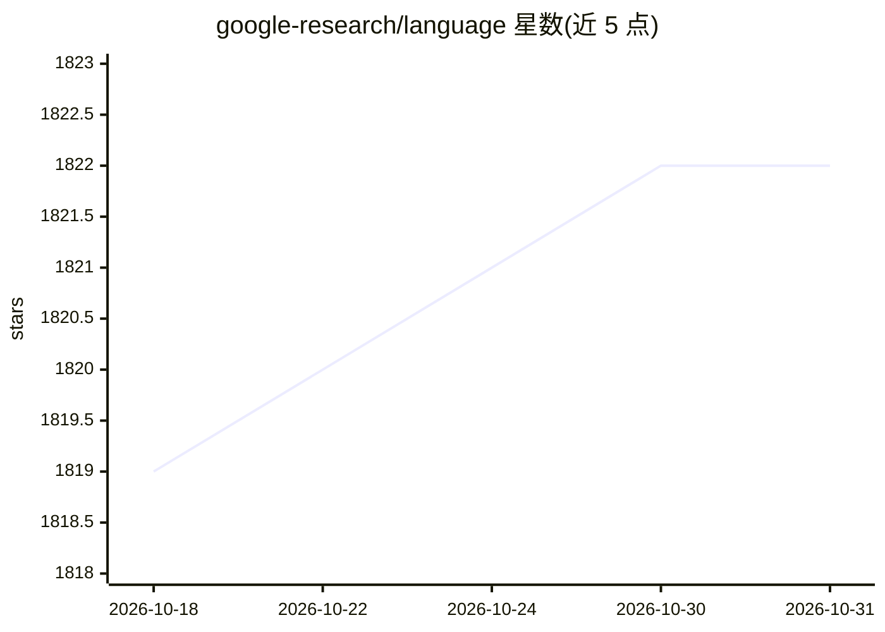

# google-research/language

⭐ 1,822 · Python · Apache-2.0 · 推送 2026-06-10 · [GitHub](https://github.com/google-research/language) · [官网](https://ai.google/research/teams/language/) · 组织维护

**Google 语言研究团队开源项目的共享代码仓库**

Google Research Language 团队的开源项目共享仓库，汇集该团队在机器学习与自然语言处理方向上开放的研究项目代码。README 仅说明仓库定位为团队项目的聚合托管处，未在可见范围内列出具体项目清单、安装方式或使用说明；仓库明确声明非官方 Google 产品。面向关注 NLP 研究代码的研究者与开发者。

## 筛选速览

| 维度 | 判定 | 备注 |
|---|---|---|
| AI 角色 | `ai-knowledge` | 知识聚合/清单类 |
| 许可风险 | `permissive` | Apache-2.0 |
| 部署形态 | `None` |  |
| 模型依赖 | — | README 未给出锁定关系 |
| 硬件要求 | — | 无带数字的原话,不猜 |
| 安装摩擦 | `low` | 无编译、无系统依赖或容器化 |
| 成熟度 | — | 结构信号不足 |

## 能力要点

- Google Research Language 团队开源项目的聚合仓库
- 主题标签为机器学习与自然语言处理研究
- 声明为非官方 Google 产品

## 适用场景

- 查找 Google 语言团队开放的研究项目代码
- 跟进 NLP 方向的研究代码发布

## 场景标签

 · 领域:自然语言处理/研究

## 证据(README 行号)

> L3: Shared repository for open-sourced projects from the
> L4: Google Research Language team.

## 星数曲线

2026-10-18 1,819 → 2026-10-31 1,822（+3）

---
*卡片 v1 · prompt 1.4 · 生成 2026-10-21 · 置信度 low · 依据 README sha `869d8b145798` · [字段定义](../../DATASET.md)*
