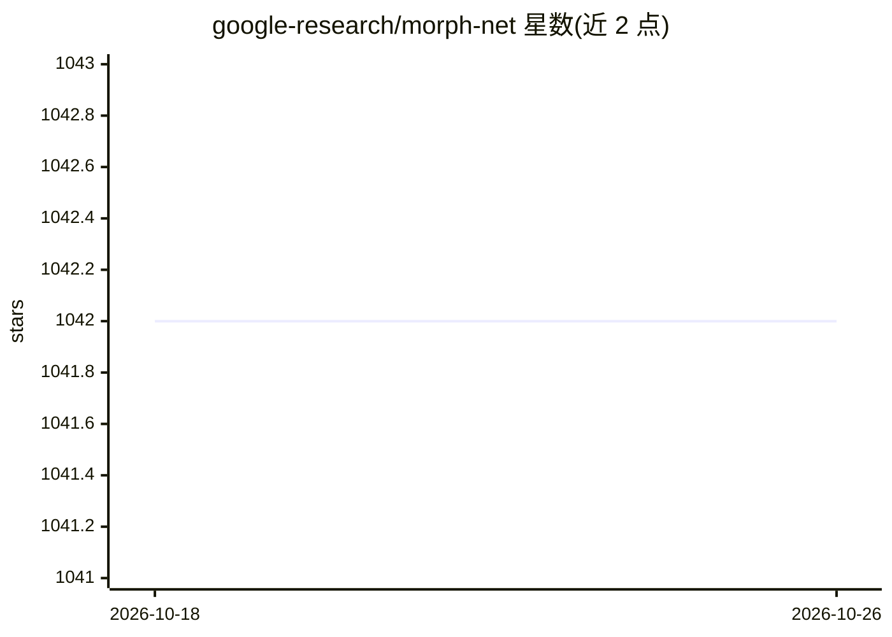

# google-research/morph-net

⭐ 1,042 · Python · Apache-2.0 · 推送 2026-10-05 · [GitHub](https://github.com/google-research/morph-net) · 组织维护

**训练期学习深度网络结构的正则化剪枝框架**

Google Research 开源的神经网络结构学习方法：在训练过程中对网络施加面向目标成本（FLOPs、模型大小、延迟）的连续正则化，压低滤波器影响力并标记可移除的输出通道，从而在给定资源约束下收缩模型；不改变网络拓扑，仅调整各卷积层通道数。以 TensorFlow Python 库形式提供，含 LogisticSigmoid（FiGS，推荐）、Gamma、GroupLasso（已弃用）三类正则化算法，通过两轮训练（结构学习+重训）与 StructureExporter 输出 JSON 结构文件。

## 筛选速览

| 维度 | 判定 | 备注 |
|---|---|---|
| AI 角色 | `ai-ecosystem` | LLM/agent 周边工具 |
| 许可风险 | `permissive` | Apache-2.0 |
| 部署形态 | `None` |  |
| 模型依赖 | — | README 未给出锁定关系 |
| 硬件要求 | — | 无带数字的原话,不猜 |
| 安装摩擦 | `low` | 无编译、无系统依赖或容器化 |
| 成熟度 | — | 结构信号不足 |

## 能力要点

- 面向 FLOPs/模型大小/硬件延迟的结构学习正则化
- 三类正则化算法（LogisticSigmoid/Gamma/GroupLasso）
- StructureExporter 以 JSON 导出每层存活通道结构
- 结构学习与重训两轮训练流程

## 适用场景

- 把已有图像分类网络压缩到满足内存/延迟约束
- 在精度与推理成本之间按正则化强度调节取舍
- 剪枝或可微架构搜索场景下调整网络通道数

## 场景标签

`模型量化` · 领域:训练与推理

## 证据(README 行号)

> L14: MorphNet is a method for learning deep network structure during training. The
> L20: Specifically, activation sparsity is induced by adding regularizers

## 星数曲线

2026-10-18 1,042 → 2026-10-26 1,042（+0）

---
*卡片 v1 · prompt 1.4 · 生成 2026-10-21 · 置信度 high · 依据 README sha `24e4df367b68` · [字段定义](../../DATASET.md)*
