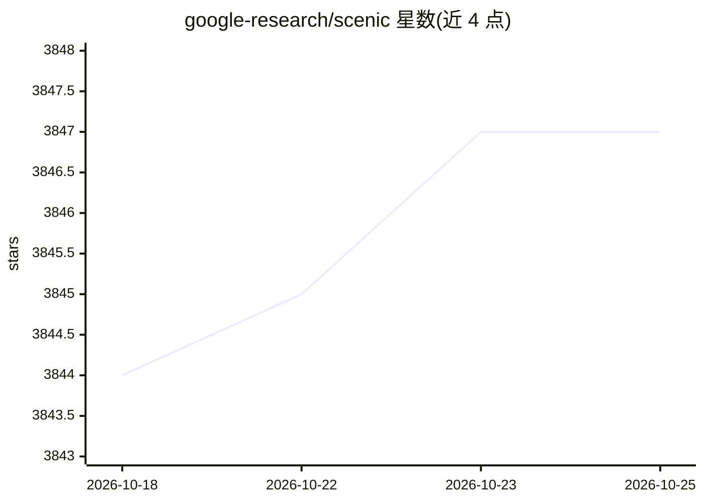

# google-research/scenic

⭐ 3,847 · Python · Apache-2.0 · 推送 2026-10-20 · [GitHub](https://github.com/google-research/scenic) · 组织维护

**基于 JAX/Flax 的注意力视觉模型研究训练库**

Google Research 维护的计算机视觉研究代码库，基于 JAX 与 Flax 构建：提供共享轻量库（数据加载管线、模型层与注意力/Transformer 实现、训练与评测循环、通用工具）以及多个完整的项目级训练/评测实现，支持多主机多设备的大规模训练。收录了在 Scenic 上开发或复现的模型（ViViT、PolyViT、DETR、ViT、CLIP、SAM 等），设计哲学上优先 fork 与复制而非增加抽象。需 Python 3.9+，通过 git clone 后 pip install 安装。

## 筛选速览

| 维度 | 判定 | 备注 |
|---|---|---|
| AI 角色 | `ai-native` | 本体是模型或模型工具 |
| 许可风险 | `permissive` | Apache-2.0 |
| 部署形态 | `library` | 以包/库形式分发 |
| 模型依赖 | — | README 未给出锁定关系 |
| 硬件要求 | — | 无带数字的原话,不猜 |
| 安装摩擦 | `low` | 无编译、无系统依赖或容器化 |
| 成熟度 | — | 结构信号不足 |

## 能力要点

- 共享库覆盖数据管线、注意力/Transformer 层实现、训练与评测循环
- 支持多主机多设备的大规模视觉模型训练
- 收录大量基于该库开发或复现的模型与基线（ViViT、DETR、ViT、CLIP、SAM 等）
- 项目级代码可在『直接运行』到『完全自定义』谱系上灵活定制

## 适用场景

- 研究者在 JAX 上快速原型化大规模视觉模型
- 复用现成基线（ResNet、ViT、DETR 等）进行对比实验
- 在图像、视频、音频与多模态任务上训练分类/分割/检测模型

## 场景标签

`模型训练` · 领域:训练与推理

## 证据(README 行号)

> L5: *Scenic* is a codebase with a focus on research around attention-based models
> L16: Scenic is developed in JAX and uses
> L95: *Scenic* aims to facilitate rapid prototyping of large-scale vision models. To

## 星数曲线

2026-10-18 3,844 → 2026-10-25 3,847（+3）

---
*卡片 v1 · prompt 1.4 · 生成 2026-10-20 · 置信度 mid · 依据 README sha `28a073ee9222` · [字段定义](../../DATASET.md)*
