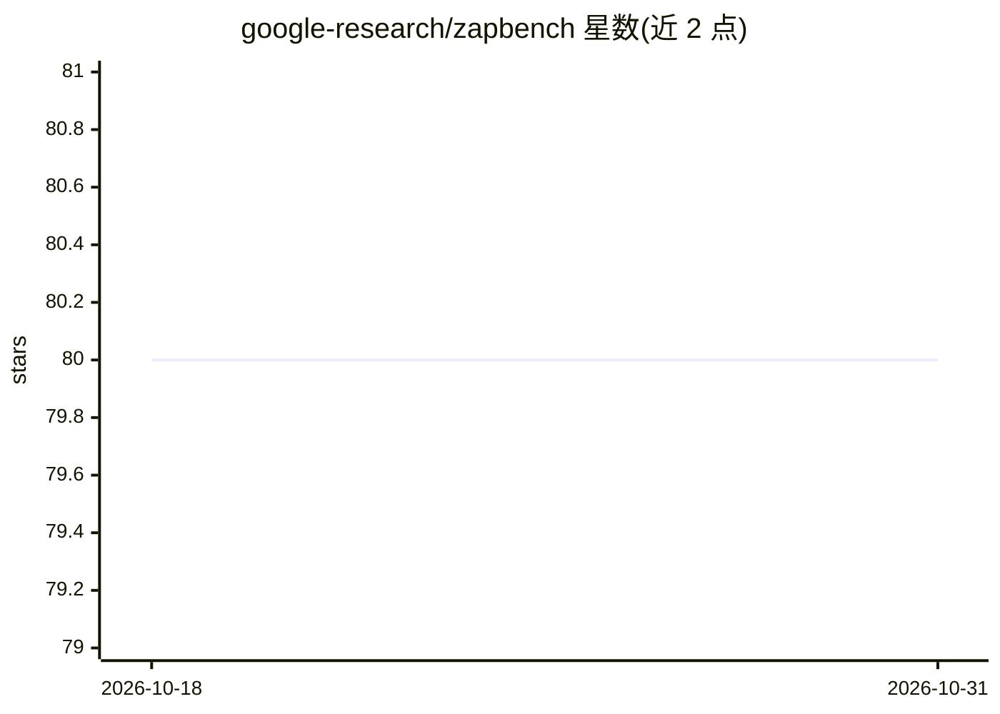

# google-research/zapbench

⭐ 80 · Python · Apache-2.0 · 推送 2026-10-05 · [GitHub](https://github.com/google-research/zapbench) · [官网](https://google-research.github.io/zapbench) · 组织维护

**斑马鱼全脑神经活动预测基准，含数据集与教程**

Google Research 维护的神经科学机器学习基准：衡量细胞分辨率下整脑（脊椎动物斑马鱼）神经活动预测方法的进展。仓库提供已发布数据集的访问说明、框架无关的训练与评测方法、论文报告方法预测结果的加载以计算自定义指标，以及 jax 交互式时间序列预测示例，均以 Colab notebook 形式提供。有配套 ICLR 论文，许可证为 Apache 2.0。

## 筛选速览

| 维度 | 判定 | 备注 |
|---|---|---|
| AI 角色 | `ai-knowledge` | 知识聚合/清单类 |
| 许可风险 | `permissive` | Apache-2.0 |
| 部署形态 | `None` |  |
| 模型依赖 | — | README 未给出锁定关系 |
| 硬件要求 | — | 无带数字的原话,不猜 |
| 安装摩擦 | `low` | 无编译、无系统依赖或容器化 |
| 成熟度 | — | 结构信号不足 |

## 能力要点

- 覆盖整脑细胞分辨率神经活动预测任务
- 提供数据集概览与访问教程
- 框架无关的训练与评测 notebook
- 可加载论文方法的预测结果计算自定义指标

## 适用场景

- 评测神经活动预测/时间序列预测方法
- 获取斑马鱼钙成像基准数据集
- 复现论文方法的预测结果做进一步分析

## 场景标签

`模型评测` `教程课程` · 领域:评测与运维

## 证据(README 行号)

> L3: The Zebrafish Activity Prediction Benchmark (ZAPBench) measures progress on the
> L9: To get started with ZAPBench, we provide tutorial-style notebooks in the `colabs/` directory:

## 星数曲线

2026-10-18 80 → 2026-10-31 80（+0）

---
*卡片 v1 · prompt 1.4 · 生成 2026-10-24 · 置信度 high · 依据 README sha `99036ff2986a` · [字段定义](../../DATASET.md)*
