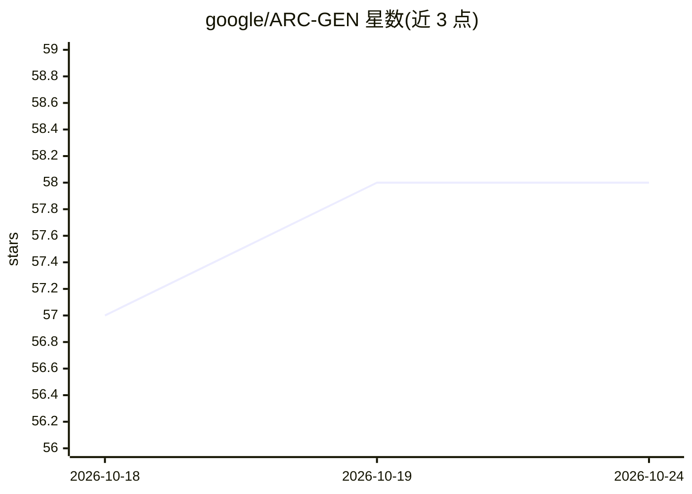

# google/ARC-GEN

⭐ 58 · Python · Apache-2.0 · 推送 2026-04-18 · [GitHub](https://github.com/google/ARC-GEN) · 组织维护

**ARC 抽象推理基准的程序化生成器：复现并扩展 ARC 任务**

Google 发布的 Abstraction and Reasoning Corpus（ARC）仿生程序化基准生成器：为每个 ARC 任务提供生成器，可按任务 ID 生成任意数量的示例对，并内置 validate 命令核验全部生成器能否集体复现原始 ARC-AGI-1 基准（400 个任务）。支持 ARC-AGI-2 的 500 个附加任务，提供变体定制示例，另发布含 10 万样本的静态数据集 ARC-GEN-100K（Kaggle）。已被 2025 Google Code Golf Championship 与 2026 NeuroGolf Championship 用作官方基准生成器。以 Python 脚本提供，git clone 递归子模块方式安装。

## 筛选速览

| 维度 | 判定 | 备注 |
|---|---|---|
| AI 角色 | `ai-ecosystem` | LLM/agent 周边工具 |
| 许可风险 | `permissive` | Apache-2.0 |
| 部署形态 | `None` |  |
| 模型依赖 | — | README 未给出锁定关系 |
| 硬件要求 | — | 无带数字的原话,不猜 |
| 安装摩擦 | `low` | 无编译、无系统依赖或容器化 |
| 成熟度 | — | 结构信号不足 |

## 能力要点

- 按任务 ID 程序化生成任意数量 ARC 示例对
- validate 命令核验 400 个生成器复现原 ARC-AGI-1 基准
- 支持 ARC-AGI-2 的 500 个附加任务
- 提供 ARC-GEN-100K 静态数据集（10 万样本，Kaggle）

## 适用场景

- 为 ARC 推理模型训练与评测生成大规模任务样本
- 复现并验证原始 ARC-AGI-1 基准
- 创建任务的定制变体以扩展测试集

## 场景标签

`模型评测` `模型训练` · 领域:评测与运维

## 证据(README 行号)

> L1: This repository contains the source code for *ARC-GEN*, a mimetic procedural benchmark generator for the Abstraction
> L28: For **validation** (i.e., to ensure that the ARC-GEN generators can collectively reproduce the original ARC-AGI-1 b

## 星数曲线

2026-10-18 57 → 2026-10-24 58（+1）

---
*卡片 v1 · prompt 1.4 · 生成 2026-10-24 · 置信度 high · 依据 README sha `cfc0842d557e` · [字段定义](../../DATASET.md)*
