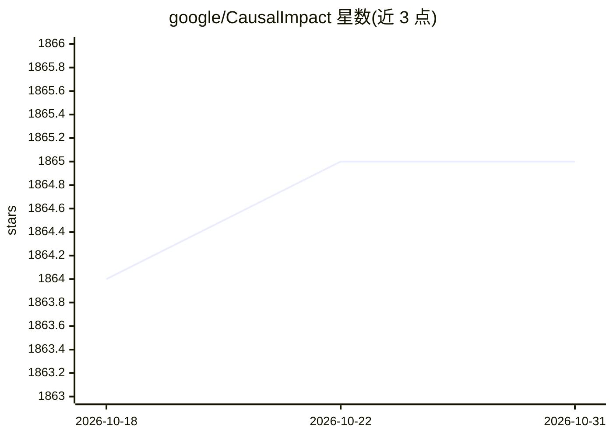

# google/CausalImpact

⭐ 1,865 · R · Apache-2.0 · 推送 2026-03-31 · [GitHub](https://github.com/google/CausalImpact) · 组织维护

**用贝叶斯结构时序模型估计干预因果效应的 R 包**

面向无随机实验场景下时间序列因果推断的 R 包：基于结构贝叶斯时序模型构造反事实，估计某次设计干预（如广告投放）对响应指标的因果效应。要求结果序列可由一组未受干预影响的对照序列解释，且干预后关系稳定；README 明确指出结论有效性依赖这些强假设。以 CRAN 包形式提供安装，另荐 TensorFlow Probability 的 Python 实现。

## 筛选速览

| 维度 | 判定 | 备注 |
|---|---|---|
| AI 角色 | `ai-native` | 本体是模型或模型工具 |
| 许可风险 | `permissive` | Apache-2.0 |
| 部署形态 | `None` |  |
| 模型依赖 | — | README 未给出锁定关系 |
| 硬件要求 | — | 无带数字的原话,不猜 |
| 安装摩擦 | `low` | 无编译、无系统依赖或容器化 |
| 成熟度 | — | 结构信号不足 |

## 能力要点

- 用贝叶斯结构时序模型估计干预的反事实与因果效应
- 适用于无法做随机实验的观测时间序列数据
- CRAN 直接安装（install.packages），附视频教程与文档

## 适用场景

- 评估广告投放带来的额外点击量等干预效果
- 在缺乏 A/B 实验数据时对时间序列做因果效应估计
- Python 用户可转用 TFP CausalImpact 实现

## 场景标签

 · 领域:统计学/因果推断

## 证据(README 行号)

> L6: ## An R package for causal inference using Bayesian structural time-series models
> L12: to address this difficulty using a structural Bayesian time-series model to

## 星数曲线

2026-10-18 1,864 → 2026-10-31 1,865（+1）

---
*卡片 v1 · prompt 1.4 · 生成 2026-10-21 · 置信度 mid · 依据 README sha `c0f9e959a927` · [字段定义](../../DATASET.md)*
