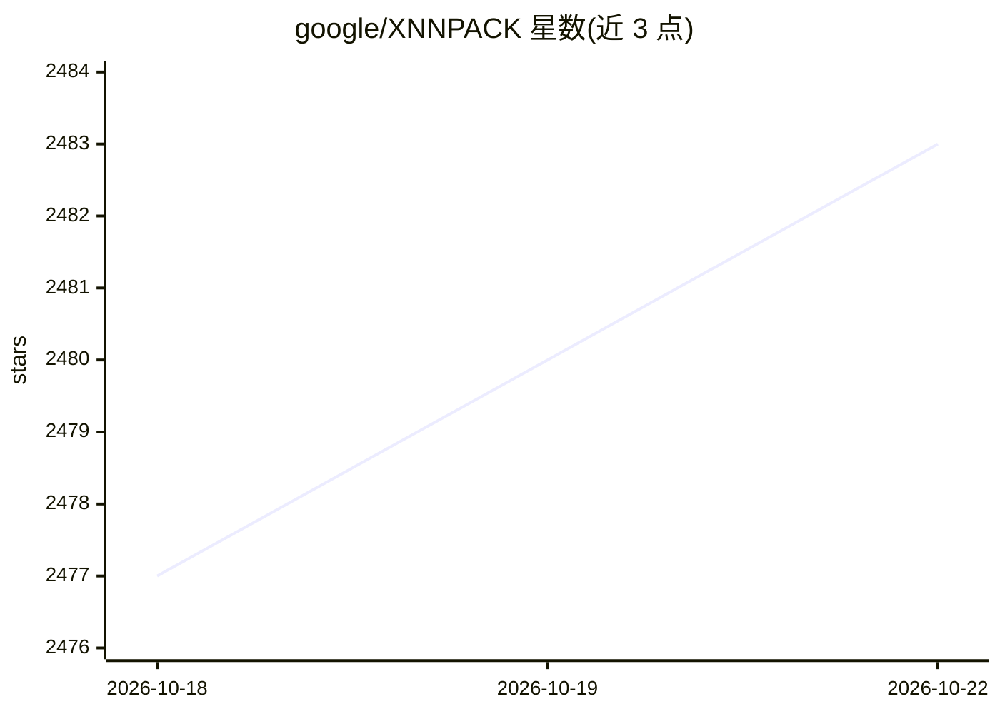

# google/XNNPACK

⭐ 2,483 · C · NOASSERTION · 推送 2026-10-21 · [GitHub](https://github.com/google/XNNPACK) · 组织维护

**面向移动/服务器/Web 的神经网络算子优化库，供框架底层加速**

XNNPACK 是在 ARM、x86、WebAssembly、RISC-V 及 Hexagon 平台上运行的神经网络推理算子库，实现卷积、池化、全连接、各类逐元素与激活算子，支持 NHWC 布局及通道子集读写。它不面向深度学习从业者直接使用，而是为 TensorFlow Lite、PyTorch Mobile、ONNX Runtime Mobile、TensorFlow.js、MediaPipe 等高层框架提供低层性能原语。README 未给出安装命令，仅列出 C11/C++17/Python 3 最低构建要求，并提供基准测试数据与算法论文列表。

## 筛选速览

| 维度 | 判定 | 备注 |
|---|---|---|
| AI 角色 | `ai-ecosystem` | LLM/agent 周边工具 |
| 许可风险 | `none` | NOASSERTION |
| 部署形态 | `None` |  |
| 模型依赖 | — | README 未给出锁定关系 |
| 硬件要求 | — | 无带数字的原话,不猜 |
| 安装摩擦 | `medium` | 含编译或系统依赖之一 |
| 成熟度 | — | 结构信号不足 |

## 能力要点

- 覆盖卷积、反卷积、池化、全连接及多种逐元素/激活/量化转换算子
- 支持 ARM64/ARMv7/x86(至AVX512)/WebAssembly(含SIMD)/RISC-V/Hexagon
- NHWC 布局下支持通道子集读写，提供零开销 Channel Split/Concat
- 被 TensorFlow Lite、PyTorch Mobile、ONNX Runtime Mobile、MediaPipe 等框架用作后端原语

## 适用场景

- 为移动端或嵌入式推理框架提供 CPU 层加速原语
- 在 WebAssembly 后端中加速浏览器端模型推理
- 查询 MobileNet 等模型在 Pixel/Raspberry Pi 上的算子级基准数据

## 场景标签

`推理引擎` · 领域:训练与推理

## 证据(README 行号)

> L3: XNNPACK is a highly optimized solution for neural network inference on ARM, x86, WebAssembly, and RISC-V platforms. 

## 星数曲线

2026-10-18 2,477 → 2026-10-22 2,483（+6）

---
*卡片 v1 · prompt 1.4 · 生成 2026-10-21 · 置信度 high · 依据 README sha `db57afd43f5f` · [字段定义](../../DATASET.md)*
