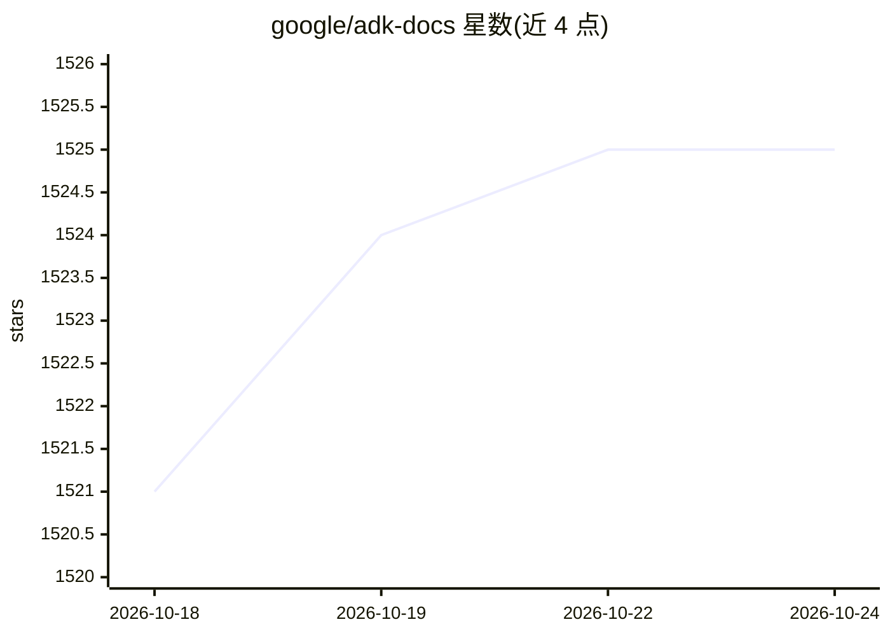

# google/adk-docs

⭐ 1,525 · Shell · Apache-2.0 · 推送 2026-10-23 · [GitHub](https://github.com/google/adk-docs) · [官网](https://adk.dev) · 组织维护

**构建、评估与部署 AI agent 的代码优先多语言框架**

Agent Development Kit (ADK) 是 google 维护的开源代码优先 AI agent 开发框架：以代码定义 agent 逻辑、工具与编排，支持预置工具、自定义函数与 OpenAPI 规范接入；支持多 agent 分层组合、内置追踪与监控，可容器化部署到 Cloud Run/GKE 或经 Agent Runtime 扩展。优化适配 Gemini 与 Google 生态，同时声明模型无关、部署无关并兼容其他框架。提供 Python/TypeScript/Go/Java/Kotlin 五种语言的入门路径，Apache 2.0 许可。

## 筛选速览

| 维度 | 判定 | 备注 |
|---|---|---|
| AI 角色 | `ai-ecosystem` | LLM/agent 周边工具 |
| 许可风险 | `permissive` | Apache-2.0 |
| 部署形态 | `library` | 以包/库形式分发 |
| 模型依赖 | — | README 未给出锁定关系 |
| 硬件要求 | — | 无带数字的原话,不猜 |
| 安装摩擦 | `low` | 无编译、无系统依赖或容器化 |
| 成熟度 | — | 结构信号不足 |

## 能力要点

- 代码优先定义 agent 逻辑、工具与编排
- 模块化多 agent 分层组合架构
- 内置追踪与监控的 agent 可观测性
- Python/TypeScript/Go/Java/Kotlin 多语言支持

## 适用场景

- 用熟悉的编程语言开发 AI agent 应用
- 编排多个专用 agent 组成复杂工作流
- 将 agent 容器化部署到云环境
- 借助 llms.txt 在 AI 代码编辑器中辅助开发

## 场景标签

`Agent 框架` `多智能体` · 领域:Agent 开发

## 证据(README 行号)

> L17: Agent Development Kit (ADK) is a flexible and modular framework for **developing
> L19: ADK is **model-agnostic**, **deployment-agnostic**, and is built for

## 星数曲线

2026-10-18 1,521 → 2026-10-24 1,525（+4）

---
*卡片 v1 · prompt 1.4 · 生成 2026-10-21 · 置信度 mid · 依据 README sha `1e92be58d301` · [字段定义](../../DATASET.md)*
