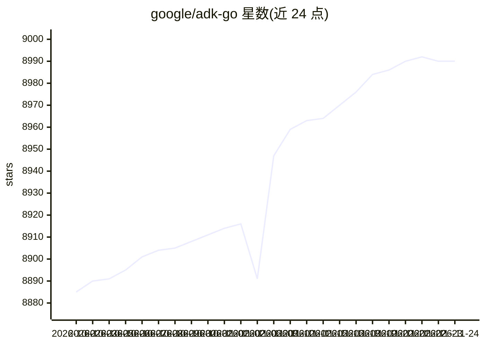

# google/adk-go

⭐ 8,999 · Go · Apache-2.0 · 推送 2026-11-23 · [GitHub](https://github.com/google/adk-go) · [官网](https://google.github.io/adk-docs/) · 组织维护

**Go 代码优先的 AI agent 构建工具包**

Agent Development Kit 的 Go 语言版本：以代码优先方式定义 agent 逻辑、工具与编排，支持模块化多 agent 系统组合、工具生态集成（预置工具/自定义函数/接入现有工具），并提供容器化部署路径（含 Google Cloud Run）。对 Gemini 做优化但保持模型无关与部署无关。面向构建云原生 agent 应用的 Go 开发者，需 Go 1.26.10+，通过 go get 安装，另提供机器可读文档索引供编码 agent 使用。

## 筛选速览

| 维度 | 判定 | 备注 |
|---|---|---|
| AI 角色 | `ai-ecosystem` | LLM/agent 周边工具 |
| 许可风险 | `permissive` | Apache-2.0 |
| 部署形态 | `None` |  |
| 模型依赖 | — | README 未给出锁定关系 |
| 硬件要求 | — | 无带数字的原话,不猜 |
| 安装摩擦 | `low` | 无编译、无系统依赖或容器化 |
| 成熟度 | — | 结构信号不足 |

## 能力要点

- 代码优先：在 Go 中直接定义 agent 逻辑、工具与编排
- 模块化多 agent 系统组合
- 模型无关、部署无关，兼容其他框架
- 机器可读文档索引 llms.txt 供编码 agent 引用

## 适用场景

- 用 Go 构建云原生 agent 应用并容器化部署
- 组合多个专职 agent 形成多 agent 系统
- 让编码 agent 基于 ADK 文档生成 agent 实现

## 场景标签

`Agent 框架` `多智能体` · 领域:Agent 开发

## 证据(README 行号)

> L11:  An open-source, code-first Go toolkit for building, evaluating, and deploying sophisticated AI agents with flexibi
> L24: Agent Development Kit (ADK) is a flexible and modular framework that applies software development principles to AI 
> L26: This Go version of ADK is ideal for developers building cloud-native agent applications, leveraging Go's strengths 

## 星数曲线

2026-10-22 8,885 → 2026-11-24 8,990（+105）

---
*卡片 v1 · prompt 1.4 · 生成 2026-11-22 · 置信度 high · 依据 README sha `354ffaa596f1` · [字段定义](../../DATASET.md)*
