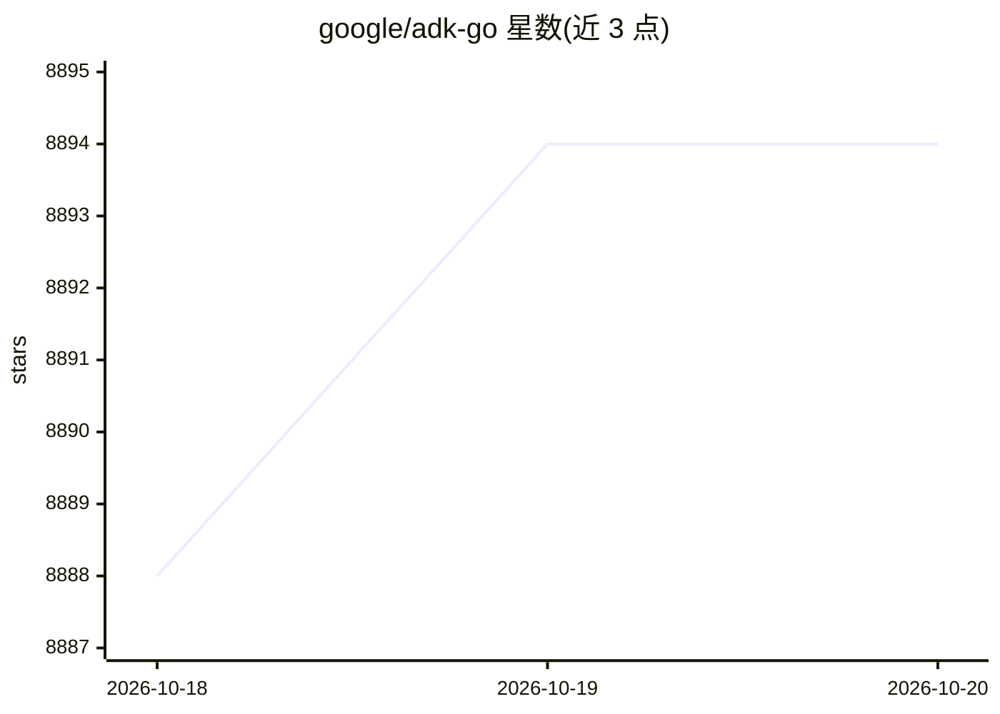

# google/adk-go

⭐ 8,894 · Go · Apache-2.0 · 推送 2026-10-19 · [GitHub](https://github.com/google/adk-go) · [官网](https://google.github.io/adk-docs/) · 组织维护

**Google 官方 Go 语言 AI agent 开发框架（ADK）**

Agent Development Kit 的 Go 实现：以代码优先方式在 Go 中定义 agent 逻辑、工具与编排，支持组合多个专门 agent 构成模块化多 agent 系统，可容器化并部署到 Google Cloud Run 等云原生环境。面向利用 Go 并发与性能优势构建云原生 agent 应用的开发者。虽为 Gemini 优化但声明模型无关、部署无关，并与其他框架兼容。通过 go get 安装，Apache 2.0 许可（internal/httprr 除外）。

## 筛选速览

| 维度 | 判定 | 备注 |
|---|---|---|
| AI 角色 | `ai-ecosystem` | LLM/agent 周边工具 |
| 许可风险 | `permissive` | Apache-2.0 |
| 部署形态 | `None` |  |
| 模型依赖 | — | README 未给出锁定关系 |
| 硬件要求 | — | 无带数字的原话,不猜 |
| 安装摩擦 | `low` | 无编译、无系统依赖或容器化 |
| 成熟度 | — | 结构信号不足 |

## 能力要点

- 在 Go 中以代码优先方式定义 agent 逻辑、工具与编排
- 组合多个专门 agent 构建模块化多 agent 系统
- 针对 Gemini 优化但模型无关、部署无关
- 支持容器化部署与 Google Cloud Run 云原生环境

## 适用场景

- 用 Go 构建云原生 AI agent 应用
- 将多个专门 agent 组合为可扩展的多 agent 系统
- 将 AI 编码助手指向 adk.dev/llms-full.txt 获取文档上下文进行开发

## 场景标签

`Agent 框架` `多智能体` · 领域:Agent 开发

## 证据(README 行号)

> L24: Agent Development Kit (ADK) is a flexible and modular framework that applies software development principles to AI 
> L26: This Go version of ADK is ideal for developers building cloud-native agent applications, leveraging Go's strengths 

## 星数曲线

2026-10-18 8,888 → 2026-10-20 8,894（+6）

---
*卡片 v1 · prompt 1.4 · 生成 2026-10-20 · 置信度 high · 依据 README sha `88d1af697666` · [字段定义](../../DATASET.md)*
