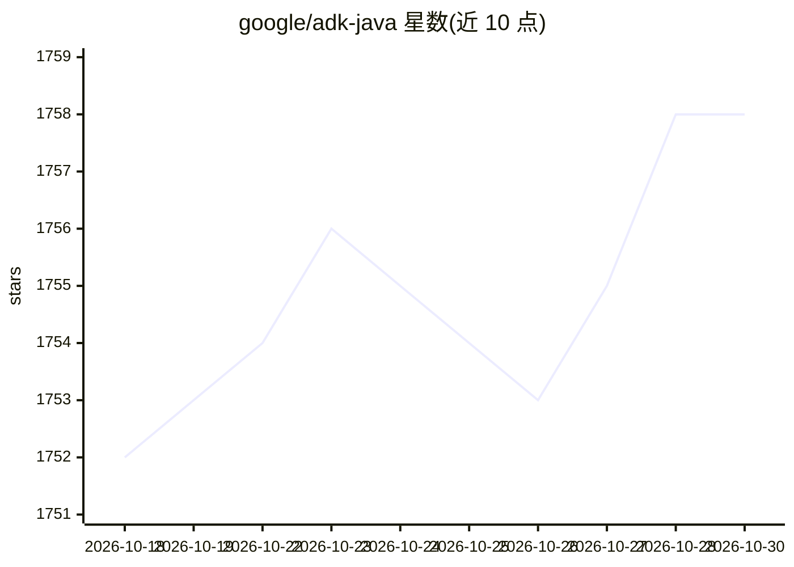

# google/adk-java

⭐ 1,758 · Java · Apache-2.0 · 推送 2026-10-29 · [GitHub](https://github.com/google/adk-java) · [官网](https://google.github.io/adk-docs/) · 组织维护

**Google 开源的 Java 版 AI agent 构建工具包**

Agent Development Kit (ADK) 的 Java 实现：以代码优先方式在 Java 中定义 agent 行为、编排与工具调用，支持组合多 agent 层级、复用预置工具/自定义函数/OpenAPI 规格工具，并与 Google Cloud 服务及 Google 生态集成。提供与 Python ADK 相同的特性与接口、内置开发 UI（测试/评估/调试 agent），评估功能标注 Coming soon，并集成 A2A 协议实现远程 agent 间通信。经 Maven Central 分发，Apache 2.0 许可。README 声明部分功能处于 Pre-GA 阶段，可能支持有限。

## 筛选速览

| 维度 | 判定 | 备注 |
|---|---|---|
| AI 角色 | `ai-ecosystem` | LLM/agent 周边工具 |
| 许可风险 | `permissive` | Apache-2.0 |
| 部署形态 | `None` |  |
| 模型依赖 | — | README 未给出锁定关系 |
| 硬件要求 | — | 无带数字的原话,不猜 |
| 安装摩擦 | `low` | 无编译、无系统依赖或容器化 |
| 成熟度 | `idea` | |

## 能力要点

- 在 Java 代码中定义 agent 逻辑、工具与编排
- 组合多个专门 agent 成层级式多 agent 系统
- 内置开发 UI 用于测试、调试与展示 agent
- 集成 A2A 协议的远程 agent 间通信

## 适用场景

- 用 Java 构建与 Google Cloud 服务集成的 AI agent 应用
- 在代码中编排多 agent 层级系统
- 使用内置开发 UI 测试和调试 agent

## 场景标签

`Agent 框架` `多智能体` · 领域:Agent 开发

## 证据(README 行号)

> L19: Agent Development Kit (ADK) is designed for developers seeking fine-grained
> L22: behavior, orchestration, and tool use directly in code, enabling robust
> L34: - **Modular Multi-Agent Systems**: Design scalable applications by composing

## 星数曲线

2026-10-18 1,752 → 2026-10-30 1,758（+6）

---
*卡片 v1 · prompt 1.4 · 生成 2026-10-21 · 置信度 high · 依据 README sha `b9aeca853747` · [字段定义](../../DATASET.md)*
